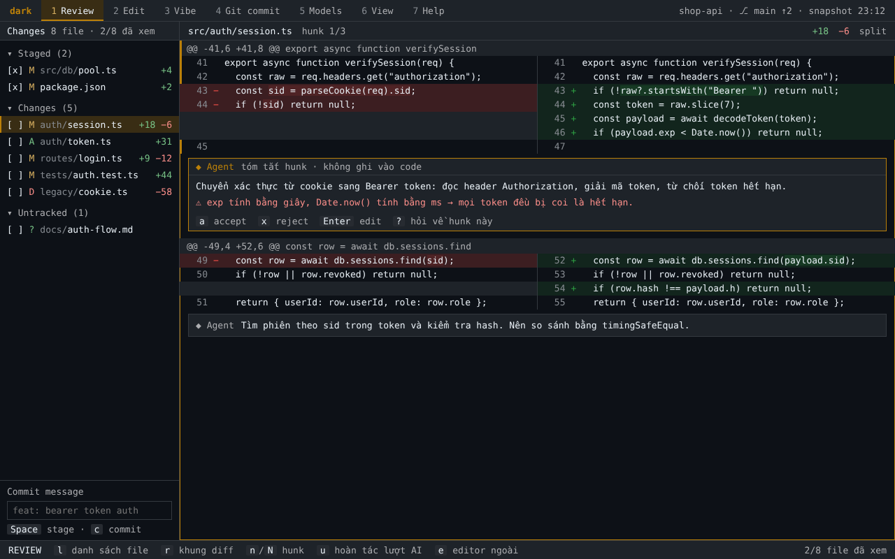

# dark

**Review từng thay đổi agent AI tạo ra: giữ phần đúng, bỏ phần sai, sửa ngay, góp ý ngược lại cho agent. Dùng agent bạn đang có, chỉ tốn vài MB RAM.**

> **Trạng thái:** M1 (khung giao diện + Review) đã triển khai, chờ chủ dự án chạy thử trước khi đóng milestone. Xem [báo cáo M1](docs/M1_VERIFICATION.md) và [PLANNING.md](docs/PLANNING.md).
> Tên "dark" là tên tạm, sẽ chốt trước v0.2.



## Vì sao có dark

Agent vừa sửa 14 file. Bạn có thật sự đọc hết không?

Sau một lượt vibe, người dùng thường chỉ có hai lựa chọn: đọc hết trong một IDE nặng, hoặc chấp nhận hết và hy vọng không có lỗi. Muốn bảo agent sửa một chỗ thì phải copy tên file, số dòng, mô tả lại từ đầu.

dark làm đúng một vòng lặp:

**vibe với agent → review từng hunk → giữ / bỏ / sửa ngay → góp ý ngược lại cho agent → commit hoặc hoàn tác**

## Giao diện: 7 tab

| Tab | Làm gì |
|---|---|
| **1 Review** | Bên trái: danh sách file đổi kiểu git panel của Zed (stage, commit). Bên phải (80%): diff 2 cột, mỗi hunk có ghi chú ngắn của agent; `Alt+a` accept, `Alt+x` reject, `Alt+Enter` sửa, `Alt+?` hỏi agent |
| **2 Edit** | Cây thư mục và editor gọn: sửa, lưu, hoàn tác, copy/paste, tìm |
| **3 Vibe** | Chọn agent: Claude Code, Codex, Gemini CLI, opencode đã cài trên máy, hoặc model qua API key. Bản đầu chạy 1 agent, về sau tối đa 6 agent cùng lúc |
| **4 Git commit** | Lịch sử commit, cây nhánh, xem diff từng commit |
| **5 Models** | Thêm model bằng API key (lưu trong kho mật khẩu của hệ điều hành) |
| **6 View, 7 Help** | Sắp có |

Màu theo theme của [Hunk](https://github.com/modem-dev/hunk) (GitHub Dark Default). Thiết kế chi tiết và ảnh mẫu: [UI_SPEC.md](docs/UI_SPEC.md), [`docs/ui/`](docs/ui/).

## Nhẹ thật sự

| | Số đo |
|---|---|
| RAM idle của bản hiện tại (M0) | ~0,56 MB trên Windows, ~0,52 MB trên Linux musl |
| File chạy | ~0,2 MB (Windows), ~0,5 MB (Linux musl), không cần Node hay Python |
| Mục tiêu | Review < 2 MB; sửa file lớn < 4 MB; `darkw` tính cả cửa sổ < 3 MB; giới hạn cứng 10 MB |

So sánh sơ bộ trên cùng một diff 30 file (Linux, bộ nhớ riêng của process):

| dark M0 | tuicr | Hunk |
|---|---|---|
| ~0,55 MB | ~14,6 MB | ~191 MB |

dark M0 chưa tải diff nên phép so này chưa công bằng cho đối thủ; sẽ đo lại sau M1 bằng [script công khai](tests/bench/compare-review-tools.py). Agent vẫn tốn RAM như khi bạn chạy chúng riêng; dark chỉ bật agent khi bạn vibe và tắt khi rảnh. Chi tiết: [ARCHITECTURE.md §6](docs/ARCHITECTURE.md#6-ngân-sách-ram).

## Lộ trình

| Giai đoạn | Phiên bản | Nội dung |
|---|---|---|
| GĐ1 | v0.1 | Review, Edit, Git commit, gọi agent CLI đã cài |
| GĐ2 | v0.2 | Agent chạy ngay trong dark (ACP), ghi chú AI cho từng hunk, Models với API key, cửa sổ riêng `darkw` trên Windows |
| GĐ3 | v1.x | Tối đa 6 agent cùng lúc, tiết kiệm token, agent riêng của dark |

Chi tiết: [PLANNING.md](docs/PLANNING.md).

## Chạy bản hiện tại

**Phím lệnh giữ Alt; riêng 1…7 đổi tab trực tiếp:** `1…7` đổi tab (`Alt+1…7` vẫn dùng được), `Alt+q` thoát; hộp xác nhận dùng `Alt+y` đồng ý / `Alt+n` hủy. Kéo đường phân cách bằng chuột trái hoặc dùng `Alt+-` thu, `Alt+=` giãn cột danh sách, `Alt+0` về mặc định. Độ rộng chỉ nhớ trong phiên; phím chữ thường không chạy lệnh. Terminal hỗ trợ thường cho giữ Shift để chọn chữ khi bật chế độ chuột.

Bản M1 có bảy tab; Review hoạt động, các tab còn lại chờ milestone tương ứng. Chạy dark trong repo Git cần review. Diff so với HEAD nên vẫn hiện thay đổi đã có trước khi mở app; snapshot phục hồi lưu trạng thái lúc mở phiên.

```powershell
cargo build --release
.\target\release\dark.exe            # Linux/macOS: ./target/release/dark
.\target\release\dark.exe --debug    # hiện RAM của chính dark
.\target\release\dark.exe --help
```

Cần Rust stable; Windows dùng toolchain MSVC và bộ C++ của Visual Studio. Lệnh kiểm tra, runner Windows/WSL, bản musl và cách đo RAM: [DEVELOPMENT.md](docs/DEVELOPMENT.md).

Trong Review: `Alt+a` giữ hunk, `Alt+x` bỏ hunk chưa stage, `Alt+n`/`Alt+Shift+n` chuyển hunk, `Alt+l`/`Alt+r` ẩn/hiện khung, `Alt+f` đổi khung, `Alt+v` đổi split/unified, `Alt+e` mở editor ngoài. `Alt+u` hỏi trước khi khôi phục về **lúc mở phiên**, gồm cả thay đổi bạn tự làm sau đó; index và nhánh giữ nguyên. Hunk chứa thay đổi đã stage bị chặn reject trong M1, không tự unstage.

File được sửa ở cửa sổ khác sẽ tự cập nhật diff qua thông báo hệ điều hành trên Windows/Linux, giữ vị trí đang đọc khi có thể. WSL đọc project trên ổ D/C dùng `dark.exe` chạy ngầm làm cầu nối: đặt cạnh binary Linux hoặc chỉ định `DARK_WATCH_HELPER=/mnt/d/duong-dan/dark.exe`. Khi build từ repo Dark trên ổ D, bản Linux tự tìm `target/release/dark.exe` của chính mã nguồn Dark; cần build bản Windows mới một lần. Không tìm/chạy executable trong project đang review. macOS hiện chưa hỗ trợ tự cập nhật; lỗi theo dõi hiện trên thanh trạng thái, vẫn có thể đổi tab để tải lại.

`DARK_SNAPSHOT_KEEP` đặt số phiên snapshot cần giữ (mặc định 10; phiên đang mở được bảo vệ). `DARK_TAB_WIDTH` đặt tab stop 1–16 (mặc định 8). `DARK_EDITOR`, rồi `VISUAL`/`EDITOR`, chọn editor ngoài; hỗ trợ `{file}` và `{line}`, ví dụ `code --wait --goto {file}:{line}`. Tham số được truyền trực tiếp, không chạy qua shell.

Bản ghi terminal thật: [160×44](docs/ui/m1/160x44.html), [80×24](docs/ui/m1/80x24.html), đặt cạnh [ảnh thiết kế](docs/ui/1-review.png). Các phần khác ảnh và giới hạn hiện tại được liệt kê trong [báo cáo M1](docs/M1_VERIFICATION.md).

Để kiểm tra chính code M1 mà không sửa repo nguồn: `powershell -NoProfile -ExecutionPolicy Bypass -File scripts/try-m1.ps1` tạo bản sao review độc lập và mở binary release đã kiểm chứng.

## Tài liệu

| Tài liệu | Nội dung |
|---|---|
| [UI_SPEC.md](docs/UI_SPEC.md) | **Chuẩn giao diện:** màu, bố cục từng tab, phím, quy tắc màn hẹp; ảnh mẫu trong [`docs/ui/`](docs/ui/) |
| [FEATURES.md](docs/FEATURES.md) | Bảng tính năng theo tab, skill và tiết kiệm token, ngoài phạm vi |
| [PLANNING.md](docs/PLANNING.md) | Ba giai đoạn, M1–M9, tiêu chí hoàn thành, quy trình, điều kiện phát hành |
| [ARCHITECTURE.md](docs/ARCHITECTURE.md) | Thành phần, ACP, git, editor, kho mật khẩu, ngân sách RAM, rủi ro |
| [SEQUENCE.md](docs/SEQUENCE.md) | Sơ đồ tuần tự các luồng chính |
| [DEVELOPMENT.md](docs/DEVELOPMENT.md) | Môi trường, lệnh kiểm tra, runner, đo RAM, benchmark |
| [M0_VERIFICATION.md](docs/M0_VERIFICATION.md) | Output kiểm chứng M0 |
| [AGENT_WORKFLOW.md](docs/AGENT_WORKFLOW.md) | Vai trò, model và quy trình của agent phát triển |

## Giấy phép

MIT hoặc Apache-2.0 (dự kiến). Bảng màu lấy từ theme mặc định của Hunk (Copyright (c) Modem Labs Inc., MIT).
