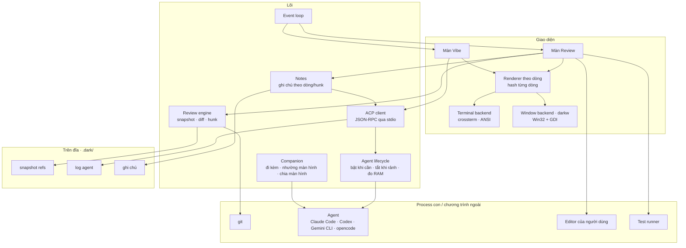

# dark — Tài liệu kiến trúc

> Phiên bản: 0.2 (sau M0) · Cập nhật: 01/11/2026
> Liên quan: [PLANNING.md](PLANNING.md) · [FEATURES.md](FEATURES.md) · [SEQUENCE.md](SEQUENCE.md) · [DEVELOPMENT.md](DEVELOPMENT.md) · [README](../README.md)

## 1. Bối cảnh và định vị

**dark = review engine + ACP client + giao diện siêu nhẹ.**

Sau một lượt vibe code, agent có thể đổi hàng chục file. Người dùng khó biết AI đã đổi gì, thường chỉ có lựa chọn giữ hết hoặc bỏ hết, và muốn bảo agent sửa lại thì phải mô tả từ đầu. dark giải quyết vòng lặp đó:

**vibe → review từng hunk → giữ/bỏ → ghi chú gửi lại agent → hoàn tác khi cần**

Ràng buộc:
- **Chất lượng vibe không giảm.** dark không tự làm agent ở bản ra mắt; nó điều khiển agent chính chủ (Claude Code, Codex, Gemini CLI, opencode) qua ACP, nên agent chạy đúng harness của hãng.
- **RAM của dark cực thấp**, đo thật ở mọi milestone. RAM của agent là của agent, đo và báo riêng.
- **Windows là hạng nhất.**

### 1.1 Các phương án đã cân nhắc và loại bỏ

| Phương án | Kết luận | Lý do |
|---|---|---|
| Ngôn ngữ Rul (`.rl`) | Loại | Chỉ có 15 opcode xử lý cột số, không có UI, chuỗi, I/O |
| GUI framework (Electron, Tauri, egui...) | Loại | Vẽ bằng GPU, giữ bộ đệm khung hình; hàng chục tới hàng trăm MB |
| TUI bằng Go / TypeScript / Python | Loại | Runtime và GC khó giữ dưới vài MB |
| **Rust, TUI + cửa sổ Win32 GDI** | **Chọn** | Không GC; GDI vẽ chữ thẳng lên cửa sổ, không giữ bộ đệm lớn |
| Tự viết agent ngay từ đầu (harness riêng) | Hoãn | Khó đuổi kịp chất lượng harness chính chủ; ACP cho chất lượng ngang ngay ngày đầu. Agent riêng làm sau, như lựa chọn siêu nhẹ |
| Editor tích hợp, repo map (tree-sitter), LSP | Loại | Tốn công và RAM; người dùng đã có editor, agent tự tìm ngữ cảnh |
| Nhúng giao diện TUI của agent (PTY + terminal thu nhỏ) | Loại | Phải giữ lưới màn hình và lịch sử cuộn: khoảng 2–4 MB nếu tự viết rất cẩn thận, 10–50 MB nếu dùng thư viện; xung đột phím; nhiều việc |
| Tự viết terminal emulator để chạy dark | Loại | Ngang công sức lõi dark (font, bộ gõ, Unicode, clipboard); `darkw` đạt cùng mục tiêu mà chỉ vẽ lưới chữ của chính dark |

## 2. Nguyên tắc thiết kế

1. **Chất lượng AI trước, RAM sau.** Không cắt context, không đổi harness của agent để tiết kiệm RAM.
2. **Việc nặng chạy ngoài process.** git, agent, test runner, editor là process con hoặc chương trình riêng.
3. **Lười nạp.** Diff tải theo file; agent chỉ chạy khi vibe; dữ liệu lớn (log agent, ghi chú) nằm trên đĩa.
4. **Một luồng xử lý trạng thái.** Không runtime async lớn. Luồng phụ chỉ dùng khi hệ điều hành bắt buộc (xem 5.1) và phải được đo.
5. **Đo thật, báo thật.** Mỗi số RAM ghi rõ loại số đo; không thay số đo khác để báo đạt.

## 3. Sơ đồ thành phần



## 4. Cấu trúc mã nguồn

```
src/
├── main.rs            # tham số (--debug, --self-test, --help, --version), chọn backend, chạy event loop   [M0 ✓]
├── app/               # trạng thái app, màn hình, xử lý phím; event.rs: nguồn sự kiện                    [M0 ✓]
├── ui/                # renderer theo dòng, terminal backend (crossterm), cắt chữ Unicode                    [M0 ✓]
├── memory/            # đo bộ nhớ theo nền tảng                                                         [M0 ✓]
├── review/            # snapshot, đọc git diff, tách hunk, giữ/bỏ, hoàn tác                              [M1]
├── notes/             # ghi chú, xuất markdown cho agent                                               [M2]
├── companion/         # phát hiện thay đổi, nhường màn hình, chia màn hình                              [M2]
├── win/               # backend cửa sổ darkw (Win32 + GDI), chỉ biên dịch trên Windows                   [M3]
├── acp/               # ACP client: JSON-RPC, phiên, duyệt quyền, đọc/ghi file thay agent                [M4]
├── agent/             # cấu hình agent, vòng đời, đo RAM cây process                                   [M4]
└── proc/              # chạy process con, đọc pipe (CREATE_NO_WINDOW trên Windows)                      [M1–M4]
src/bin/darkw.rs       # file chạy cửa sổ riêng (subsystem windows)                                       [M3]
scripts/, tests/       # runner kiểm chứng, test RAM, benchmark so sánh                                 [M0 ✓]
```

## 5. Các thành phần

### 5.1 Event loop
- **Hiện trạng (M0):** dùng `crossterm::event::read/poll` đồng bộ trên một luồng. `src/app/event.rs` tách phần chờ sự kiện. Chế độ thường chờ phím/resize vô thời hạn; `--debug` có hạn chờ để cập nhật bộ nhớ mỗi giây. Mã ứng dụng không tạo worker hay runtime async (Windows có thể có thread loader của hệ thống).
- **Từ M1 (git) và M4 (ACP):** phải chờ đồng thời phím bấm và output của process con. Trên Linux/macOS dùng `poll` trên nhiều fd. **Trên Windows không có cách chờ chung đơn giản** cho console input và pipe ẩn danh trong một luồng. Phương án, chốt ở kế hoạch M4 kèm số đo RAM:
  - Một luồng đọc pipe nhỏ cho mỗi process con, đẩy dữ liệu vào hàng đợi có giới hạn rồi đánh thức luồng chính (đơn giản, mỗi luồng tốn stack riêng, có thể đặt stack nhỏ).
  - Named pipe + overlapped I/O, chờ bằng `WaitForMultipleObjects` cùng handle console (một luồng, phức tạp hơn).
- Với git ở M1, gọi đồng bộ và ngắn là đủ (diff lớn thì đọc theo file).

### 5.2 Renderer và hai backend
- **Hiện trạng (M0):** renderer tự viết, giữ một danh sách hash theo dòng và một chuỗi tạm tái sử dụng, không giữ hai frame. Resize hoặc lỗi ghi làm mất hiệu lực cache; chỉ ghi nhận frame sau khi flush thành công.
- **Cắt chữ (M0):** theo cụm grapheme và độ rộng cột, không theo byte. `unicode-width 0.2.3` tính độ rộng, `unicode-segmentation 1.13.3` giữ dấu tổ hợp và emoji nguyên cụm; cả hai tắt default features, khóa trong `Cargo.lock`, không thêm dependency gián tiếp. Tab mở rộng theo mốc 8 cột (cấu hình ở M1). Ký tự điều khiển thay bằng khoảng trắng; chừa ô cuối để tránh cuộn terminal.
- **Phục hồi terminal (M0):** guard khi thoát/lỗi và panic hook, kể cả khi release dùng `panic = "abort"`. Windows lưu và khôi phục console mode gốc.
- **Hai backend dùng chung renderer:**
  - *Terminal backend* (`dark`): ghi mã ANSI qua crossterm. Chạy trong mọi terminal.
  - *Window backend* (`darkw`, M3): xem 5.6.

### 5.3 Review engine (M1)
- **Snapshot:** trước mỗi lượt agent, ghi một ref git riêng (ví dụ `refs/dark/snapshots/<n>`) trỏ tới trạng thái working tree, không đụng vào index hay nhánh của người dùng. Ở chế độ đi kèm, snapshot được tạo khi người dùng mở dark hoặc bấm vibe.
- **Đọc diff:** gọi `git diff` so với snapshot, tách hunk; chỉ giữ hunk của file đang xem, file khác tải khi cần.
- **Giữ hunk:** giữ nguyên trên working tree (tùy chọn stage). **Bỏ hunk:** áp ngược patch của hunk đó vào working tree.
- **Hoàn tác cả lượt:** khôi phục working tree về snapshot, có xác nhận; không xóa file người dùng tạo ngoài phạm vi lượt AI mà không hỏi.
- Mọi thao tác ghi đều kiểm tra lỗi của git và báo rõ, không để repo ở trạng thái nửa vời.

### 5.4 Ghi chú (M2)
- Ghi chú gắn với file + dòng/khoảng dòng/hunk, lưu trong `.dark/notes/`.
- Gửi cho agent: qua ACP (M4) như một prompt có vị trí file:dòng; ở chế độ đi kèm, xuất markdown ra clipboard hoặc file để người dùng dán, hoặc để agent đọc qua skill.

### 5.5 Tích hợp agent

| Chế độ | Cách hoạt động | RAM thêm cho dark | Milestone |
|---|---|---|---|
| **Đi kèm** | Agent chạy ở cửa sổ khác; dark phát hiện thay đổi qua git | ~0 | M2 |
| **Nhường màn hình** | dark rời màn hình, trao terminal cho agent CLI, agent thoát thì quay lại Review | ~0 | M2 (chỉ bản terminal) |
| **Chia màn hình** | Ra lệnh cho Windows Terminal / tmux / WezTerm mở agent ở khung bên cạnh | ~0 | M2 |
| **ACP** | Agent chạy ngầm, dark tự vẽ hội thoại; chạy được cả trong `darkw` | khoảng 0,5–1 MB | M4 |

**ACP (Agent Client Protocol):** chuẩn mở (Zed, JetBrains), JSON-RPC 2.0 qua stdin/stdout của process con. dark là client: khởi tạo phiên, gửi prompt, nhận cập nhật (tin nhắn, kế hoạch, lệnh, file), trả lời yêu cầu xin quyền. Nếu agent dùng cơ chế đọc/ghi file của client, dark nhận nội dung trước khi ghi và cho người dùng duyệt hunk.

| Agent | Cách kết nối |
|---|---|
| Gemini CLI | ACP gốc: `gemini --acp` |
| opencode | ACP gốc: `opencode acp` (kèm hơn 75 nhà cung cấp model API) |
| Codex | App-server (JSON-RPC gốc của Codex, không cần Node) hoặc `npx @agentclientprotocol/codex-acp` |
| Claude Code | `npx @agentclientprotocol/claude-agent-acp`; mặc định API key (xem mục 8) |

Lệnh và tên package cần kiểm tra lại với phiên bản mới nhất khi làm M4. SDK Rust của ACP đã 1.0; phải xem dependency kéo theo (có thể có async runtime). Nếu nặng, tự viết JSON-RPC tối giản; quyết định dựa trên bài test RAM.

**Vòng đời agent (M4):** khởi động khi bấm vibe; tự tắt sau một khoảng rảnh; mỗi lúc một agent; vượt ngưỡng RAM thì chờ hết lượt, tắt và mở lại với tính năng tiếp tục phiên của agent; chế độ gọn khởi động agent với cấu hình tối thiểu nếu agent hỗ trợ; đo RAM cả cây process của agent. Giới hạn cứng (`NODE_OPTIONS=--max-old-space-size`, Job Object trên Windows) là tùy chọn, tắt mặc định, chỉ dùng khi đã có snapshot để khôi phục.

### 5.6 Cửa sổ riêng `darkw` (M3, Windows)
- File chạy riêng `darkw.exe` (subsystem windows), giống `pythonw.exe`: nhấp đúp mở thẳng cửa sổ, không có conhost/OpenConsole đi kèm. `dark.exe` (bản terminal) giữ nguyên.
- Vẽ bằng GDI: mỗi dòng của renderer vẽ bằng `TextOutW` với font monospace, chỉ vẽ lại dòng đã đổi, không giữ bộ đệm toàn khung hình. Ảnh cửa sổ do DWM quản lý (phần này mọi cửa sổ đều có, kể cả terminal).
- Phải làm: bộ gõ tiếng Việt (Unikey, EVKey, bộ gõ Windows) qua `WM_CHAR` và đặt vị trí khung gõ; clipboard; DPI theo màn hình; icon, tên cửa sổ.
- Mọi process con khởi động với `CREATE_NO_WINDOW` để không chớp cửa sổ console.
- Hạn chế: emoji và CJK hiển thị kém hơn terminal hiện đại; trình đọc màn hình cần làm thêm; nhường màn hình cho agent CLI không dùng được (agent CLI cần terminal), nên vibe trong `darkw` đi qua ACP.
- Không thêm crate mới: bật thêm feature của `windows-sys` (`Win32_Graphics_Gdi`, `Win32_UI_WindowsAndMessaging`...).
- Bắt đầu bằng **bản thử 1–2 ngày** để đo RAM trước khi cam kết (xem PLANNING M3).

### 5.7 Chạy test và commit
- `!` chạy lệnh test trong cấu hình (hoặc tự phát hiện), chỉ hiện lỗi đầu tiên và vị trí.
- `c` commit các thay đổi đã giữ; nếu có agent, nhờ agent gợi ý message.

### 5.8 Đo bộ nhớ (M0)
- Windows: `GetProcessMemoryInfo` với `PROCESS_MEMORY_COUNTERS_EX2` lấy `PrivateWorkingSetSize`; không nhầm với `PrivateUsage` (commit) hay `WorkingSetSize` (gồm trang chia sẻ). Không hỗ trợ thì báo `n/a` kèm lý do.
- Linux: `VmRSS` trong `/proc/self/status` là số quyết định ngân sách; private resident (`Private_Clean + Private_Dirty`) và PSS trong `smaps_rollup` là số bổ sung.
- macOS: `proc_pidinfo(PROC_PIDTASKINFO)` lấy resident size.
- Mã theo nền tảng nằm trong `src/memory/mod.rs`, chỉ biên dịch phần tương ứng.

## 6. Ngân sách RAM

### 6.1 Đã đo (M0, sau sửa review)

| Nền tảng | File chạy | RAM idle |
|---|---|---|
| Windows (private working set) | 212.480 byte | 557.056 byte |
| Linux musl, WSL (VmRSS) | 537.464 byte | 524.288 byte |
| Linux GNU, WSL (VmRSS) | ~396 KB | ~2,1 MB, trong đó ~1,6 MB là glibc dùng chung; phần riêng ~0,5 MB |

Bản phát hành Linux dùng musl; GNU dùng khi phát triển. Bộ cấp phát musl có thể chậm hơn khi cấp phát dày, cần đo lại tốc độ ở các milestone sau. Chi tiết: [M0_VERIFICATION.md](M0_VERIFICATION.md).

### 6.2 So sánh với công cụ cùng nhóm

Đo ngày 01/11/2026 trên máy Linux (container đám mây, bản dark GNU) bằng [`tests/bench/compare-review-tools.py`](../tests/bench/compare-review-tools.py): repo mẫu 30 file (960 dòng thêm, 510 dòng xóa), PTY 160×45, một lượt khởi động không tính, 3 lượt đo, cả ba công cụ đều hiển thị diff ở mọi lượt. Số là trung vị.

| | Bộ nhớ riêng (private) | RSS | Đỉnh RSS | File chạy |
|---|---|---|---|---|
| dark M0 | ~0,55 MB | ~2,2 MB | ~2,2 MB | ~0,4 MB |
| tuicr 0.28.0 (Rust) | ~14,6 MB | ~17 MB | ~17 MB | ~19,7 MB |
| Hunk (bản đóng gói Bun, chạy thẳng) | ~191 MB | ~238 MB | ~275 MB | ~193 MB |

RSS của dark GNU gồm ~1,6 MB glibc dùng chung; bản musl phát hành có RSS ~0,5 MB.

**Chưa công bằng cho đối thủ:** dark M0 chưa tải diff nào, trong khi tuicr và Hunk đang hiển thị 30 file. Phải đo lại sau M1 bằng đúng script này trước khi dùng con số để giới thiệu.

### 6.3 Mục tiêu

| Tình huống | Mục tiêu cho dark |
|---|---|
| Review diff ~30 file / ~3.000 dòng (M1) | dưới 2.000.000 byte |
| `darkw` khi rảnh, tính cả cửa sổ (M3) | dưới 3.000.000 byte |
| Đang nhận luồng ACP từ agent (M4) | dưới 4.000.000 byte, không tính agent |
| **Giới hạn cứng mọi tình huống** | **dưới 10.000.000 byte** |

Không tính vào ngân sách của dark: cửa sổ terminal (với bản `dark`), git, agent, test runner, editor. Các số này đo và báo riêng.

### 6.4 Đo lường
- `--self-test` chạy không cần terminal, đi qua các màn hình và resize rồi lấy nhiều mẫu idle; test trong `tests/ram/` chỉ áp ngân sách ở `cargo test --release`.
- Kiểm tra terminal thật: `tests/ram/windows-console.ps1`, `tests/ram/linux-terminal.py`; runner đầy đủ trong `scripts/`.
- Từ M1, bài test RAM phải dùng repo mẫu có diff thật; từ M4, thêm agent giả lập phát luồng ACP.

## 7. Cấu hình (dự kiến)

`~/.config/dark/config.toml` (Windows: `%APPDATA%\dark\config.toml`):

```toml
editor = "code -g {file}:{line}"   # mặc định dùng $EDITOR
test = "cargo test"                # lệnh cho phím !
tab_width = 4

[agent]
default = "codex"
idle_stop_minutes = 5
restart_above_mb = 1024            # khởi động lại khi agent phình quá ngưỡng
lean = true                        # cấu hình tối thiểu nếu agent hỗ trợ

[agents.codex]
command = ["codex", "app-server"]

[agents.gemini]
command = ["gemini", "--acp"]

[agents.opencode]
command = ["opencode", "acp"]

[agents.claude]
command = ["npx", "@agentclientprotocol/claude-agent-acp"]
env_from = ["ANTHROPIC_API_KEY"]   # chỉ đọc từ biến môi trường
```

## 8. Gói thuê bao và điều khoản

| Agent | Dùng gói thuê bao khi chạy qua dark |
|---|---|
| Codex | Nhiều khả năng được: Codex chính chủ tự xử lý đăng nhập ChatGPT; OpenAI mở "Sign in with ChatGPT" cho công cụ bên thứ ba (29/9/2026). Kiểm tra lại điều khoản khi làm M4 |
| Gemini CLI | Nhiều khả năng được: Gemini CLI chính chủ, Google tự hỗ trợ ACP |
| Claude Code | **Chưa chắc chắn.** Bộ chuyển đổi ACP dùng Claude Agent SDK; tài liệu Anthropic (2/2026) từng ghi việc dùng token gói Pro/Max trong Agent SDK là vi phạm. Mặc định dùng API key; người dùng gói Pro/Max vibe bằng Claude Code chính chủ ở chế độ đi kèm |

Không bao giờ dùng plugin đăng nhập không chính thức.

## 9. Rủi ro và cách giảm

| Rủi ro | Mức | Cách giảm |
|---|---|---|
| Đối thủ đã có phần review (tuicr, Hunk, Zed) | Cao | Khác biệt ở cả vòng lặp: giữ/bỏ hunk trên code, ghi chú gửi thẳng agent qua ACP, hoàn tác cả lượt, siêu nhẹ, Windows hạng nhất |
| Windows khó chờ đồng thời console và pipe | Trung bình | Chốt phương án ở kế hoạch M4 kèm số đo |
| `darkw` không đạt RAM hoặc bộ gõ tiếng Việt lỗi | Trung bình | Bản thử 1–2 ngày trước khi cam kết; bản terminal vẫn là dự phòng |
| ACP hoặc giao thức agent thay đổi | Trung bình | Lớp `acp/` tách riêng, test với từng agent, ghim phiên bản đã kiểm |
| Điều khoản gói thuê bao (Claude) | Trung bình | API key mặc định; chế độ đi kèm cho gói thuê bao |
| RAM phình dần khi thêm tính năng | Trung bình | Bài test RAM ở mọi milestone; benchmark so sánh trước khi công bố số |
| Tên "dark" trùng crates.io, Darklang, khó tìm kiếm | Thấp (hoãn) | Đổi tên trước khi ra mắt công khai |
