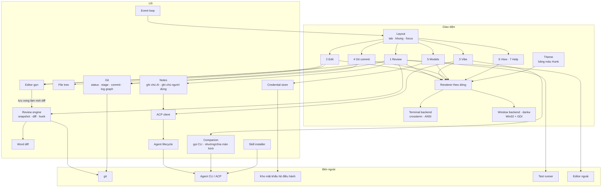

# dark — Tài liệu kiến trúc

> Phiên bản: 0.3 · Cập nhật: 01/11/2026
> Liên quan: [PLANNING.md](PLANNING.md) · [FEATURES.md](FEATURES.md) · [UI_SPEC.md](UI_SPEC.md) · [SEQUENCE.md](SEQUENCE.md) · [DEVELOPMENT.md](DEVELOPMENT.md) · [README](../README.md)

## 1. Bối cảnh và định vị

**dark = review engine + editor gọn + git + ACP client, trong một giao diện siêu nhẹ 7 tab.**

Sau một lượt vibe code, agent có thể đổi hàng chục file. dark giải quyết vòng lặp:

**vibe → review từng hunk → giữ / bỏ / sửa ngay → góp ý ngược lại cho agent → commit hoặc hoàn tác**

Ràng buộc:
- **Chất lượng vibe không giảm.** dark điều khiển agent chính chủ (Claude Code, Codex, Gemini CLI, opencode) qua CLI hoặc ACP, nên agent chạy đúng harness của hãng. Agent riêng của dark chỉ là lựa chọn thêm ở M9.
- **RAM của dark cực thấp**, đo thật ở mọi milestone. RAM của agent đo và báo riêng.
- **Giao diện theo [UI_SPEC.md](UI_SPEC.md)**, màu theo theme của Hunk.
- **Windows là hạng nhất.**

### 1.1 Các phương án đã cân nhắc

| Phương án | Kết luận | Lý do |
|---|---|---|
| Ngôn ngữ Rul (`.rl`) | Loại | Chỉ có 15 opcode xử lý cột số, không có UI, chuỗi, I/O |
| GUI framework (Electron, Tauri, egui...) | Loại | Vẽ bằng GPU, giữ bộ đệm khung hình; hàng chục tới hàng trăm MB |
| TUI bằng Go / TypeScript / Python | Loại | Runtime và GC khó giữ dưới vài MB |
| **Rust, TUI + cửa sổ Win32 GDI** | **Chọn** | Không GC; GDI vẽ chữ thẳng lên cửa sổ, không giữ bộ đệm lớn |
| ratatui | Loại (M0) | Renderer tự viết theo dòng nhẹ hơn, đủ cho bố cục khung cố định |
| Tự làm agent ngay từ đầu | Hoãn tới M9 | Khó đuổi kịp chất lượng harness chính chủ; CLI + ACP cho chất lượng ngang ngay |
| Editor kiểu IDE, LSP, repo map | Loại | Tốn công và RAM; người dùng đã có editor đầy đủ, agent tự tìm ngữ cảnh |
| **Editor gọn + cây thư mục** | **Chọn (M2)** | Sửa nhanh không rời app; cây thư mục tải dần |
| **Diff 2 cột (split)** | **Chọn (M1)** | Dễ so sánh; tự về 1 cột khi hẹp |
| Nhúng giao diện TUI của agent (PTY + terminal thu nhỏ) | Loại | Lưới màn hình + lịch sử cuộn: 2–4 MB nếu tự viết rất cẩn thận, 10–50 MB nếu dùng thư viện; xung đột phím |
| Tự viết terminal emulator | Loại | Ngang công sức lõi dark; `darkw` chỉ vẽ lưới chữ của dark |

## 2. Nguyên tắc thiết kế

1. **Chất lượng AI trước, RAM sau.** Không cắt context, không đổi harness của agent để tiết kiệm RAM hay token.
2. **Việc nặng chạy ngoài process.** git, agent, test runner, editor ngoài là process con hoặc chương trình riêng.
3. **Lười nạp.** Diff tải theo file, cây thư mục theo thư mục, lịch sử commit theo trang, agent chỉ chạy khi vibe; dữ liệu lớn (log agent, ghi chú, cache) nằm trên đĩa.
4. **Một luồng xử lý trạng thái.** Luồng phụ chỉ khi hệ điều hành bắt buộc (xem 5.1) và phải được đo.
5. **Một nguồn màu duy nhất** (module theme), không viết mã màu ở nơi khác.
6. **Đo thật, báo thật.** Mỗi số RAM ghi rõ loại số đo; không thay số đo khác để báo đạt.

## 3. Sơ đồ thành phần



## 4. Cấu trúc mã nguồn

```
src/
├── main.rs            # tham số (--debug, --self-test, --help, --version), chọn backend, event loop     [M0 ✓]
├── app/               # trạng thái app, tab đang chọn, khung active, xử lý phím theo ngữ cảnh               [M0 ✓, mở rộng M1]
├── ui/
│   ├── renderer.rs    # renderer theo dòng, cắt chữ Unicode                                              [M0 ✓]
│   ├── terminal.rs    # terminal backend (crossterm)                                                     [M0 ✓]
│   ├── theme.rs       # bảng màu theo UI_SPEC §2, quy đổi 256 màu, NO_COLOR                               [M1]
│   ├── layout.rs      # thanh tab, thanh trạng thái, chia khung, viền active, màn hẹp                      [M1]
│   └── widgets/       # danh sách có dòng chọn, ô nhập, nút, hộp xác nhận, khung ghi chú                  [M1+]
├── screens/           # review, edit, vibe, git, models, soon (View/Help)                                [M1–M6]
├── review/            # snapshot, đọc diff, tách hunk, căn dòng 2 cột, accept/reject, hoàn tác            [M1]
├── diff/              # diff theo chữ trong dòng                                                         [M1]
├── git/               # status theo nhóm, stage/unstage, commit, log --graph theo trang                  [M1–M3]
├── editor/            # bộ đệm, con trỏ theo grapheme, undo, chọn chữ, clipboard, tìm, lưu an toàn        [M2]
├── tree/              # cây thư mục tải dần, tôn trọng .gitignore                                       [M2]
├── companion/         # phát hiện agent CLI, gọi CLI, nhường/chia màn hình, theo dõi thay đổi            [M3]
├── win/               # backend cửa sổ darkw (Win32 + GDI), chỉ biên dịch trên Windows                   [M4]
├── acp/               # ACP client: JSON-RPC, phiên, duyệt quyền, đọc/ghi file thay agent                [M5]
├── agent/             # cấu hình agent, vòng đời, đo RAM cây process, worktree (M7)                      [M5, M7]
├── notes/             # ghi chú AI và ghi chú người dùng, cache theo nội dung hunk                       [M5]
├── skills/            # cài/gỡ skill dark-notes, dark-feedback vào thư mục của từng agent                [M5]
├── credentials/       # lưu/đọc API key qua kho mật khẩu hệ điều hành                                    [M6]
├── memory/            # đo bộ nhớ theo nền tảng                                                         [M0 ✓]
└── proc/              # chạy process con, đọc pipe (CREATE_NO_WINDOW trên Windows)                      [M1+]
src/bin/darkw.rs       # file chạy cửa sổ riêng (subsystem windows)                                       [M4]
skills/                # nội dung skill dark-notes, dark-feedback đi kèm (văn bản thuần, không script)      [M5]
docs/ui/               # ảnh tham chiếu giao diện                                                         [✓]
scripts/, tests/       # runner kiểm chứng, test RAM, test bố cục, benchmark so sánh                     [M0 ✓]
```

## 5. Các thành phần

### 5.1 Event loop
- **Hiện trạng (M0):** `crossterm::event::read/poll` đồng bộ trên một luồng; `src/app/event.rs` tách phần chờ sự kiện. Chế độ thường chờ vô thời hạn; `--debug` cập nhật bộ nhớ mỗi giây. Mã ứng dụng không tạo worker hay runtime async.
- **git (M1–M3):** gọi đồng bộ, ngắn; diff đọc theo file; lịch sử theo trang. Thao tác git nào có thể chậm (repo lớn) phải có giới hạn thời gian và báo "đang tải".
- **Agent (M3 theo dõi thay đổi, M5 ACP):** cần chờ đồng thời phím và output process con. Linux/macOS dùng `poll` nhiều fd. **Windows không có cách chờ chung đơn giản** cho console input và pipe ẩn danh; chốt ở kế hoạch M5 kèm số đo RAM: luồng đọc pipe nhỏ đẩy vào hàng đợi có giới hạn, hoặc named pipe + overlapped I/O với `WaitForMultipleObjects`.

### 5.2 Renderer, theme và bố cục
- **Renderer (M0):** một danh sách hash theo dòng và một chuỗi tạm tái sử dụng, không giữ hai frame; resize hoặc lỗi ghi làm mất hiệu lực cache; chỉ ghi nhận frame sau khi flush thành công.
- **Cắt chữ (M0):** theo cụm grapheme và độ rộng cột (`unicode-width 0.2.3`, `unicode-segmentation 1.13.3`, tắt default features). Tab mở rộng theo mốc 8 cột (cấu hình được từ M1). Ký tự điều khiển thay bằng khoảng trắng; chừa ô cuối để tránh cuộn terminal.
- **Màu (M1):** renderer phải hỗ trợ màu nền và màu chữ theo từng đoạn trong dòng (cần cho diff theo chữ). Hash của dòng tính cả màu. Màu lấy từ `ui/theme.rs` theo [UI_SPEC.md §2](UI_SPEC.md#2-màu-theme); terminal không có 24-bit thì quy về 256 màu; `NO_COLOR` thì bỏ màu.
- **Bố cục (M1):** thanh tab (dòng 0), nội dung, thanh trạng thái (dòng cuối); chia khung theo tỉ lệ có tối thiểu/tối đa; khung active có viền `accent`; quy tắc màn hẹp theo UI_SPEC §3.4.
- **Phục hồi terminal (M0):** guard khi thoát/lỗi và panic hook, kể cả với `panic = "abort"`; Windows lưu và khôi phục console mode gốc.
- **Hai backend dùng chung renderer:** terminal (`dark`) và cửa sổ (`darkw`, xem 5.9).

### 5.3 Review engine (M1)
- **Snapshot:** trước mỗi lượt agent, ghi một ref git riêng (ví dụ `refs/dark/snapshots/<n>`) trỏ tới trạng thái working tree, không đụng index hay nhánh của người dùng. Ở chế độ đi kèm, snapshot tạo khi mở dark hoặc khi gọi agent từ tab Vibe.
- **Diff:** `git diff` so với snapshot, tách hunk; chỉ giữ hunk của file đang xem.
- **Căn dòng 2 cột:** trong mỗi hunk, ghép dòng xóa với dòng thêm tương ứng; bên thiếu dòng hiện ô trống. Khung < 120 cột thì về 1 cột.
- **Diff theo chữ (`diff/`):** với mỗi cặp dòng xóa/thêm, tìm phần chữ khác nhau để tô nền đậm hơn. Chỉ tính cho hunk đang hiển thị. Tự viết hay dùng crate nhỏ (`similar`, `imara-diff`) chốt ở kế hoạch M1.
- **Accept:** giữ nguyên working tree, đánh dấu đã xem. **Reject:** áp ngược patch của hunk vào working tree.
- **Hoàn tác cả lượt:** khôi phục working tree về snapshot, có xác nhận; không xóa file người dùng tạo ngoài phạm vi lượt AI mà không hỏi.
- Mọi thao tác ghi kiểm tra lỗi của git và báo rõ, không để repo ở trạng thái nửa vời.

### 5.4 Git panel và tab Git commit (M1–M3)
- **Status theo nhóm:** `git status --porcelain=v2` tách Staged / Changes / Untracked, kèm số dòng `+/−` (`git diff --numstat`, `--cached`).
- **Stage / unstage / bỏ thay đổi:** `git add`, `git restore --staged`, `git restore` (bỏ thay đổi luôn có xác nhận).
- **Commit:** `git commit` với message từ ô nhập; chỉ commit phần đã stage; báo lỗi hook rõ ràng.
- **Lịch sử:** `git log --graph` với định dạng cố định, đọc theo trang khoảng 200 commit; tô màu từng nhánh theo cột của graph; nhãn nhánh/tag từ `--decorate`.
- **Diff commit:** `git show` đưa vào khung diff của Review ở chế độ chỉ đọc.
- Không làm rebase, merge, checkout, push (xem FEATURES §6).

### 5.5 Editor gọn và cây thư mục (M2)
- **Mục đích:** sửa nhanh không rời app. Không có tự hoàn thành, đa con trỏ, nhiều tab file, chế độ vim.
- **Chế độ:** `Enter` ở Review mở file tại dòng của hunk; tab Edit mở file từ cây thư mục. Khi đang gõ, phím chữ dùng để gõ, phím tắt đi qua `Ctrl`, đổi tab bằng `Alt-1…7`; `Ctrl-C` là copy.
- **Bộ đệm:** chỉ nạp file đang sửa; mảng dòng hay rope (`ropey`) chốt ở kế hoạch M2 theo số đo với file 10.000 dòng. File quá lớn, nhị phân, không UTF-8: chỉ xem.
- **Con trỏ:** di chuyển theo cụm grapheme, cột theo độ rộng hiển thị; chỉ vẽ dòng trong khung nhìn.
- **Undo/redo:** lưu thao tác chèn/xóa kèm vị trí, gộp thao tác gõ liên tiếp, giới hạn số bước và dung lượng.
- **Lưu an toàn:** giữ LF/CRLF, BOM, quyền file; ghi file tạm cạnh file gốc rồi đổi tên; trước khi lưu kiểm tra file có bị đổi từ bên ngoài không, nếu có thì hỏi.
- **Clipboard:** Windows dùng API clipboard hệ thống (bật thêm feature của `windows-sys`); nơi khác dùng OSC 52 nếu terminal hỗ trợ, nếu không thì clipboard nội bộ.
- **Cây thư mục:** đọc từng thư mục khi mở; danh sách file theo `git ls-files` và file chưa track không bị ignore; đánh dấu thư mục chứa file đã đổi.
- **Liên kết review:** lưu xong review engine đọc lại diff của file đó; lề trái editor đánh dấu dòng khác snapshot.

### 5.6 Ghi chú (M5)
- **Ghi chú AI mỗi hunk:** do agent viết qua skill **dark-notes** ngay cuối lượt (agent đang có sẵn ngữ cảnh nên gần như không tốn thêm token). Định dạng JSON trong `.dark/notes/<snapshot>/`: file, khoảng dòng, tóm tắt, cảnh báo. dark ghép ghi chú với hunk theo nội dung (hash của hunk), nên ghi chú cũ không gắn nhầm khi code đổi.
- Nếu agent không dùng skill (ví dụ đi kèm mà chưa cài), dark có thể nhờ agent tóm tắt riêng từng file khi người dùng yêu cầu, chỉ gửi các hunk của file đó.
- **Ghi chú của người dùng:** gắn file + dòng/khoảng dòng/hunk, lưu `.dark/notes/`, gửi cho agent qua ACP (skill **dark-feedback** hướng dẫn agent cách đọc).
- Ghi chú không bao giờ ghi vào file mã nguồn.

### 5.7 Tích hợp agent

| Chế độ | Cách hoạt động | RAM thêm cho dark | Milestone |
|---|---|---|---|
| **Đi kèm** | Agent chạy ở cửa sổ khác; dark phát hiện thay đổi qua git | ~0 | M3 |
| **Gọi CLI** | Tab Vibe phát hiện CLI đã cài; nhường màn hình (bản terminal) hoặc chia màn hình (Windows Terminal, tmux, WezTerm) | ~0 | M3 |
| **ACP** | Agent chạy ngầm trong ô của tab Vibe, dark tự vẽ hội thoại; chạy được trong `darkw` | 0,5–1 MB mỗi agent | M5 |
| **Nhiều agent** | Tối đa 6 ô; mỗi agent một git worktree riêng, review từng worktree | +0,5–1 MB mỗi agent | M7 |
| **Agent riêng** | Gọi API trực tiếp qua `curl` | 2–3 MB | M9 |

**ACP (Agent Client Protocol):** chuẩn mở (Zed, JetBrains), JSON-RPC 2.0 qua stdin/stdout. dark là client: khởi tạo phiên, gửi prompt, nhận cập nhật, trả lời yêu cầu xin quyền; nếu agent dùng cơ chế đọc/ghi file của client, dark cho người dùng duyệt hunk trước khi ghi.

| Agent | Kết nối |
|---|---|
| Codex | App-server (JSON-RPC gốc, không cần Node) hoặc `npx @agentclientprotocol/codex-acp` |
| Gemini CLI | ACP gốc: `gemini --acp` |
| opencode | ACP gốc: `opencode acp`; cũng là đường chạy model qua API key (M6) |
| Claude Code | `npx @agentclientprotocol/claude-agent-acp`, mặc định API key (xem mục 8) |

Lệnh và tên package kiểm tra lại khi làm M5. SDK Rust của ACP đã 1.0; nếu kéo theo dependency nặng thì tự viết JSON-RPC tối giản, quyết định theo bài test RAM.

**Vòng đời agent (M5):** bật khi vibe; tự tắt sau khoảng rảnh; mỗi lúc một agent (tới M7); vượt ngưỡng RAM thì chờ hết lượt, tắt và mở lại với phiên cũ; chế độ gọn nếu agent hỗ trợ; đo RAM cả cây process. Giới hạn cứng (`NODE_OPTIONS`, Job Object) là tùy chọn, tắt mặc định.

**Skill (M5, M8):** skill là file `SKILL.md`; dark cài vào thư mục skill của agent đang dùng **sau khi hỏi người dùng**, tên có tiền tố `dark-`, không đè skill có sẵn, liệt kê/tắt/gỡ được. Skill đi kèm là văn bản thuần, không chứa script. Chỉ cài ít skill vì tên và mô tả của mọi skill được nạp vào mỗi lượt của agent.

### 5.8 Models và kho mật khẩu (M6)
- Tab Models lưu API key qua `credentials/`: Windows Credential Manager (`CredWriteW`/`CredReadW` của `windows-sys`); macOS Keychain và Linux Secret Service ở M9. Không có kho mật khẩu thì chỉ đọc từ biến môi trường.
- Key **không bao giờ** ghi ra file cấu hình, log hay báo lỗi; có test quét log và file cấu hình.
- Kiểm tra kết nối bằng một request nhỏ tới nhà cung cấp.
- Model qua API key chạy bằng opencode (key truyền qua biến môi trường của process con), cho tới khi có agent riêng ở M9.

### 5.9 Cửa sổ riêng `darkw` (M4, Windows)
- File chạy riêng `darkw.exe` (subsystem windows): nhấp đúp mở thẳng cửa sổ, không có conhost/OpenConsole đi kèm. `dark.exe` giữ nguyên.
- Vẽ bằng GDI: mỗi dòng của renderer vẽ bằng `TextOutW`, font monospace, chỉ vẽ lại dòng đổi, không giữ bộ đệm toàn khung hình.
- Phải làm: bộ gõ tiếng Việt qua `WM_CHAR` và vị trí khung gõ; clipboard; DPI theo màn hình; icon, tên cửa sổ. Mọi process con khởi động với `CREATE_NO_WINDOW`.
- Hạn chế: emoji và CJK kém hơn terminal hiện đại; gọi agent CLI bằng nhường màn hình không dùng được, nên vibe trong `darkw` qua ACP (M5).
- Bắt đầu bằng bản thử 1–2 ngày để đo RAM trước khi cam kết.

### 5.10 Chạy test
- `!` chạy lệnh test trong cấu hình (hoặc tự phát hiện), chỉ hiện lỗi đầu tiên và vị trí; output ghi ra đĩa, RAM chỉ giữ phần hiển thị.

### 5.11 Đo bộ nhớ (M0)
- Windows: `GetProcessMemoryInfo` với `PROCESS_MEMORY_COUNTERS_EX2` lấy `PrivateWorkingSetSize`; không nhầm `PrivateUsage` hay `WorkingSetSize`. Không hỗ trợ thì `n/a` kèm lý do.
- Linux: `VmRSS` là số quyết định ngân sách; private resident và PSS trong `smaps_rollup` là số bổ sung.
- macOS: `proc_pidinfo(PROC_PIDTASKINFO)`.

## 6. Ngân sách RAM

### 6.1 Đã đo (M0, sau sửa review)

| Nền tảng | File chạy | RAM idle |
|---|---|---|
| Windows (private working set) | 212.480 byte | 557.056 byte |
| Linux musl, WSL (VmRSS) | 537.464 byte | 524.288 byte |
| Linux GNU, WSL (VmRSS) | ~396 KB | ~2,1 MB, trong đó ~1,6 MB là glibc dùng chung; phần riêng ~0,5 MB |

Bản phát hành Linux dùng musl; GNU dùng khi phát triển. Bộ cấp phát musl có thể chậm hơn khi cấp phát dày, cần đo lại tốc độ ở các milestone sau. Chi tiết: [M0_VERIFICATION.md](M0_VERIFICATION.md).

### 6.2 So sánh với công cụ cùng nhóm

Đo ngày 01/11/2026 trên máy Linux (container đám mây, bản dark GNU) bằng [`tests/bench/compare-review-tools.py`](../tests/bench/compare-review-tools.py): repo mẫu 30 file (960 dòng thêm, 510 dòng xóa), PTY 160×45, một lượt khởi động không tính, 3 lượt đo, cả ba công cụ đều hiển thị diff ở mọi lượt. Số là trung vị.

| | Bộ nhớ riêng (private) | RSS | Đỉnh RSS | File chạy |
|---|---|---|---|---|
| dark M0 | ~0,55 MB | ~2,2 MB | ~2,2 MB | ~0,4 MB |
| tuicr 0.28.0 (Rust) | ~14,6 MB | ~17 MB | ~17 MB | ~19,7 MB |
| Hunk (bản đóng gói Bun, chạy thẳng) | ~191 MB | ~238 MB | ~275 MB | ~193 MB |

RSS của dark GNU gồm ~1,6 MB glibc dùng chung; bản musl phát hành có RSS ~0,5 MB. **Chưa công bằng cho đối thủ:** dark M0 chưa tải diff; phải đo lại sau M1 bằng đúng script này trước khi dùng con số để giới thiệu.

### 6.3 Mục tiêu

| Tình huống | Mục tiêu cho dark | Milestone |
|---|---|---|
| Review diff ~30 file / ~3.000 dòng | < 2.000.000 byte | M1 |
| Sửa file 10.000 dòng | < 4.000.000 byte | M2 |
| Tab Git với 200 commit | thêm < 500.000 byte | M3 |
| `darkw` khi rảnh, tính cả cửa sổ | < 3.000.000 byte | M4 |
| Đang nhận luồng ACP từ 1 agent | < 4.000.000 byte | M5 |
| 6 agent cùng lúc | < 10.000.000 byte | M7 |
| Agent riêng của dark | < 6.000.000 byte | M9 |
| **Giới hạn cứng mọi tình huống** | **< 10.000.000 byte** | |

Không tính vào ngân sách: cửa sổ terminal (với bản `dark`), git, agent, test runner, editor ngoài. Các số này đo và báo riêng. RAM của agent thường hàng trăm MB mỗi agent (trừ Codex nhẹ hơn), nên 6 agent có thể tốn 1–4 GB của cả máy.

### 6.4 Đo lường
- `--self-test` chạy không cần terminal; test trong `tests/ram/` chỉ áp ngân sách ở `cargo test --release`.
- Kiểm tra terminal thật: `tests/ram/windows-console.ps1`, `tests/ram/linux-terminal.py`; runner trong `scripts/`.
- Từ M1, test RAM dùng repo mẫu có diff thật; từ M5, thêm agent giả lập phát luồng ACP; từ M7, 6 agent giả lập.

## 7. Cấu hình (dự kiến)

`~/.config/dark/config.toml` (Windows: `%APPDATA%\dark\config.toml`). **Không chứa API key.**

```toml
editor = "code -g {file}:{line}"   # editor ngoài cho phím e; mặc định $EDITOR
test = "cargo test"                # lệnh cho phím !
tab_width = 4
diff_view = "auto"                 # auto | split | unified

[agent]
default = "codex"
idle_stop_minutes = 5
restart_above_mb = 1024
lean = true
install_skills = "ask"             # ask | never

[agents.codex]
command = ["codex", "app-server"]

[agents.gemini]
command = ["gemini", "--acp"]

[agents.opencode]
command = ["opencode", "acp"]

[agents.claude]
command = ["npx", "@agentclientprotocol/claude-agent-acp"]
```

## 8. Gói thuê bao và điều khoản

| Agent | Dùng gói thuê bao khi chạy qua dark |
|---|---|
| Codex | Nhiều khả năng được: Codex chính chủ tự xử lý đăng nhập ChatGPT; OpenAI mở "Sign in with ChatGPT" cho công cụ bên thứ ba (29/9/2026). Kiểm tra lại khi làm M5 |
| Gemini CLI | Nhiều khả năng được: Gemini CLI chính chủ, Google tự hỗ trợ ACP |
| Claude Code | **Chưa chắc chắn** khi chạy qua bộ chuyển đổi ACP (dùng Claude Agent SDK; tài liệu Anthropic 2/2026 từng ghi việc dùng token gói Pro/Max trong Agent SDK là vi phạm). Mặc định API key; người dùng gói Pro/Max gọi Claude Code chính chủ từ tab Vibe ở chế độ gọi CLI (M3) |

Không bao giờ dùng plugin đăng nhập không chính thức.

## 9. Rủi ro và cách giảm

| Rủi ro | Mức | Cách giảm |
|---|---|---|
| Phạm vi lớn (7 tab), kéo dài thời gian | Cao | Danh sách tính năng cố định cho từng milestone; ra v0.1 sau M3 |
| Đối thủ đã có phần review (tuicr, Hunk, Zed) | Cao | Khác biệt ở cả vòng lặp: giữ/bỏ/sửa hunk, ghi chú AI và góp ý qua ACP, hoàn tác cả lượt, siêu nhẹ, Windows hạng nhất |
| Mất dữ liệu khi lưu, reject hoặc ghi đè thay đổi của agent | Cao | Ghi file tạm rồi đổi tên; kiểm tra file bị đổi từ bên ngoài; thao tác nguy hiểm có xác nhận; test LF/CRLF, BOM, Unicode |
| Giao diện lệch khỏi thiết kế | Trung bình | UI_SPEC là chuẩn; ảnh trong `docs/ui/`; test bố cục ở nhiều độ rộng; theme có test mã hex |
| Windows khó chờ đồng thời console và pipe | Trung bình | Chốt ở kế hoạch M5 kèm số đo |
| `darkw` không đạt RAM hoặc bộ gõ tiếng Việt lỗi | Trung bình | Bản thử trước; bản terminal là dự phòng |
| ACP hoặc giao thức agent thay đổi | Trung bình | Lớp `acp/` tách riêng, ghim phiên bản đã kiểm |
| Lộ API key | Cao | Kho mật khẩu hệ điều hành; test quét log và file cấu hình |
| Nhiều agent sửa đè nhau | Cao | Mỗi agent một git worktree (M7) |
| Skill làm tốn token hoặc giảm chất lượng | Trung bình | Ít skill; mỗi skill qua bộ eval (M8) |
| RAM phình khi thêm tab và agent | Trung bình | Bài test RAM và benchmark ở mọi milestone |
| Tên "dark" trùng crates.io, Darklang | Thấp (hoãn) | Đổi tên trước v0.2 |
