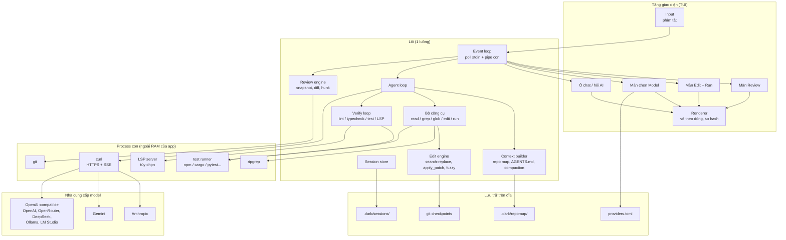

# dark — Tài liệu kiến trúc

> Phiên bản: 0.1 (pre-MVP) · Cập nhật: 01/11/2026
> Liên quan: [PLANNING.md](PLANNING.md) · [FEATURES.md](FEATURES.md) · [SEQUENCE.md](SEQUENCE.md) · [README.md](../README.md)

## 1. Bối cảnh

**dark** là một ứng dụng chạy trong terminal (TUI) dành cho vibe coder, với hai vai trò:

1. **Trạm review sau khi vibe code**: xem AI đã sửa những gì, giữ hoặc bỏ từng hunk, hỏi AI khi không hiểu, sửa nhanh và chạy test.
2. **Harness vibe code đầy đủ**: cắm được nhiều model AI (giống opencode), với chất lượng gọi model **ngang bằng hoặc tốt hơn** opencode và các harness khác.

Ràng buộc cứng: **process của app dùng dưới 10 MB RAM**, nhưng **tuyệt đối không hy sinh chất lượng AI để đổi lấy RAM**.

### 1.1 Các phương án đã cân nhắc và loại bỏ

| Phương án | Kết luận | Lý do |
|---|---|---|
| Dùng ngôn ngữ **Rul (`.rl`)** (github.com/rul-lang/rul) | Loại | Chỉ có 15 opcode xử lý cột số `f64`: không có UI, vòng lặp, rẽ nhánh, chuỗi hay I/O. Binary AOT chỉ chạy Linux x86_64 có AVX2. Repo mới 4 ngày tuổi, một tác giả, benchmark so sánh chưa công bằng |
| App GUI (Electron, Tauri, egui...) | Loại | Riêng bộ đệm vẽ một cửa sổ Full HD đã khoảng 8 MB, chưa kể font và GPU context. Electron/WebView tốn hàng trăm MB |
| TUI viết bằng Go | Loại | Runtime và GC khiến khó giữ ổn định dưới 10 MB |
| TUI viết bằng TypeScript/Bun hoặc Python | Loại | Chỉ riêng runtime đã vượt 10 MB |
| TUI viết bằng Zig/C | Không chọn | Nhẹ hơn nữa (có thể dưới 1 MB) nhưng tốn công gấp nhiều lần, AI hỗ trợ kém hơn |
| **TUI viết bằng Rust** | **Chọn** | Không có GC, RAM dễ kiểm soát, hệ sinh thái TUI tốt, AI viết Rust ổn, compiler bắt lỗi khi vibe code |

## 2. Nguyên tắc thiết kế

1. **Chất lượng AI trước, RAM sau.** Không bao giờ cắt context gửi cho model, không tự chế parser JSON, không bỏ tính năng làm tăng chất lượng chỉ để tiết kiệm RAM.
2. **Việc nặng chạy ngoài process.** HTTPS (`curl`), git, ripgrep, test runner, LSP đều là process con. RAM của chúng không tính vào app.
3. **Lười nạp (lazy).** Tính năng chưa dùng thì chưa tốn RAM: grammar tree-sitter, màn Edit, LSP chỉ nạp khi cần, dùng xong thì giải phóng.
4. **Một luồng duy nhất.** Không dùng runtime async lớn. Một vòng lặp sự kiện chờ bàn phím và output của các process con.
5. **Dữ liệu lớn nằm trên đĩa.** Lịch sử chat, repo map, checkpoint nằm trên đĩa. RAM chỉ giữ phần đang hiển thị hoặc đang xử lý.
6. **Giao diện tối giản không giúp giảm RAM**, chỉ giúp dễ nhìn. Bộ đệm màn hình terminal có kích thước như nhau dù ô có chữ hay trống. RAM do các tính năng chạy ngầm quyết định.

## 3. Sơ đồ thành phần



## 4. Cấu trúc mã nguồn (dự kiến)

```
dark/
├── Cargo.toml
├── src/
│   ├── main.rs            # khởi động, đọc config, chạy event loop
│   ├── app/               # event loop, trạng thái app, điều hướng màn hình
│   ├── ui/                # renderer theo dòng, các màn Review/Edit/Models, widget nhỏ
│   ├── review/            # snapshot, đọc git diff, tách hunk, giữ/bỏ hunk
│   ├── editor/            # buffer (rope), undo/redo, tìm/thay, tô màu đơn giản
│   ├── agent/             # vòng lặp agent, quản lý lượt, compaction
│   ├── tools/             # read, grep, glob, edit, run_command
│   ├── edit/              # engine áp dụng sửa đổi (search/replace, apply_patch, fuzzy)
│   ├── context/           # repo map (tree-sitter, lazy), AGENTS.md/CLAUDE.md
│   ├── verify/            # chạy lint/typecheck/test, quản lý vòng đời LSP
│   ├── providers/         # adapter Anthropic, Gemini, OpenAI-compatible; SSE parser
│   ├── proc/              # spawn và đọc stream từ process con (curl, git, rg...)
│   └── store/             # lưu session, cache repo map ra đĩa
├── docs/
└── tests/
    ├── ram/               # bài test giới hạn RSS
    └── eval/              # bộ task so sánh chất lượng với opencode
```

## 5. Các thành phần chính

### 5.1 Event loop
- Một luồng, dùng `polling`/`mio` (hoặc tương đương) để chờ đồng thời: phím bấm (stdin), output của `curl`, `git`, test runner, LSP.
- Không dùng `tokio` đầy đủ, tiết kiệm khoảng 0,5–1,5 MB.
- M0 dùng `crossterm::event::read/poll` đồng bộ trên cùng một luồng xử lý. `src/app/event.rs` tách phần chờ sự kiện để bổ sung nguồn pipe sau; M0 chưa triển khai process con hoặc multiplex pipe. Chế độ thường chờ phím/resize; `--debug` có thời hạn chờ để cập nhật bộ nhớ mỗi giây. Số thread hệ điều hành trên Windows có thể gồm thread loader của hệ thống; mã ứng dụng không tạo worker hay runtime async.

### 5.2 Renderer
- Tự viết renderer theo dòng: chỉ nhớ hash của từng dòng ở frame trước, dòng nào đổi thì vẽ lại dòng đó bằng mã ANSI. Hỗ trợ Windows qua `crossterm`.
- Phương án dự phòng: dùng `ratatui` nếu tự viết tốn quá nhiều công (tốn thêm khoảng 0,5–1,5 MB cho 2 bộ đệm ô).
- M0 đã chọn renderer tự viết: một danh sách hash theo dòng và một chuỗi tạm tái sử dụng, không giữ hai frame. Resize làm mất hiệu lực cache; chỉ ghi nhận frame sau khi flush thành công. Lỗi ghi làm mất hiệu lực cache để lần sau vẽ lại đầy đủ.
- Terminal có guard khi thoát/lỗi và panic hook phục hồi trước khi in chẩn đoán, kể cả release `panic="abort"`. Windows lưu và phục hồi console mode gốc. Không thể phục hồi sau khi hệ điều hành cưỡng chế kết thúc process.

### 5.3 Review engine
- **Snapshot**: trước mỗi phiên vibe/agent, tạo một checkpoint git (commit tạm hoặc ref riêng) làm mốc so sánh.
- Đọc diff bằng cách gọi `git diff`, tách thành từng hunk, chỉ giữ hunk trong RAM.
- Giữ hunk = `git apply --cached` (stage) hoặc giữ nguyên working tree; bỏ hunk = áp ngược patch.

### 5.4 Providers
- Ba adapter: **Anthropic** (native), **Gemini** (native), **OpenAI-compatible** (dùng chung cho OpenAI, OpenRouter, DeepSeek, Groq, Ollama, LM Studio...).
- Gọi HTTPS bằng cách spawn `curl` (có sẵn trên Windows 10+, macOS, Linux), ghi request body vào stdin của curl, đọc stream SSE từ stdout.
  - Phương án thay thế: nhúng `ureq` + `rustls`. App nặng hơn 1–2 MB nhưng tổng RAM toàn hệ thống thấp hơn.
- Truyền đủ tham số: reasoning/thinking, `max_tokens`, không cắt output.
- **Prompt caching**: dùng `cache_control` với Anthropic; tận dụng cache tự động của các provider khác.
- API key đọc từ biến môi trường, không lưu dạng chữ trong config.
- Parse JSON bằng thư viện chuẩn (`serde_json` hoặc tương đương). Không tự viết.

### 5.5 Agent loop và bộ công cụ
- Công cụ: `read_file`, `grep` (ripgrep), `glob`, `edit_file`, `run_command`.
- Mô tả công cụ rõ ràng, có ví dụ; lỗi trả về cho model phải cụ thể để model tự sửa.
- **Định dạng sửa theo họ model**: mỗi họ model dùng kiểu sửa file mà nó quen nhất (search/replace hoặc apply_patch).
- **Mặc định cần duyệt**: patch của AI hiện dạng diff, người dùng duyệt rồi mới ghi file (có thể tắt trong config).

### 5.6 Edit engine
- Tìm và thay chính xác. Nếu không khớp thì thử khớp gần đúng (bỏ qua khác biệt khoảng trắng, thụt lề).
- Không khớp được hoặc khớp nhiều chỗ: báo lỗi cụ thể (kèm đoạn gần giống nhất) để model thử lại.
- Mỗi lượt sửa của AI đều có checkpoint git trước đó để hoàn tác.

### 5.7 Context builder
- **Repo map**: dùng tree-sitter trích danh sách hàm/class của project. Grammar chỉ nạp cho ngôn ngữ cần dùng, kết quả lưu vào `.dark/repomap/`, parse tree được giải phóng ngay.
- Đọc quy tắc riêng của project: `AGENTS.md`, `CLAUDE.md`.
- **Compaction**: khi gần hết context window, tóm tắt các lượt cũ thay vì cắt bỏ.
- Lịch sử hội thoại lưu trên đĩa; mỗi lượt đọc từ đĩa và stream thẳng vào curl, nên model luôn nhận **đầy đủ** context.

### 5.8 Verify loop
- Sau mỗi lần AI sửa: chạy lint, typecheck, test liên quan; đưa lỗi lại cho model.
- **LSP (tùy chọn)**: chỉ khởi động cho ngôn ngữ của file vừa được sửa, tự tắt sau vài phút không dùng, có thể tắt hẳn trong config. Lưu ý: LSP tốn RAM ở process riêng (rust-analyzer có thể tới hàng GB, tsserver hàng trăm MB).

### 5.9 Editor
- Buffer dạng rope (`ropey`), undo/redo, tìm và thay, nhảy dòng, tìm file kiểu fuzzy.
- Tô màu cú pháp **đơn giản** (từ khóa, chuỗi, comment), chỉ cho các dòng đang hiển thị. tree-sitter chỉ dùng cho repo map, không dùng để tô màu.

## 6. Ngân sách RAM

### 6.1 Ước tính theo thành phần (chưa đo thực tế)

| Thành phần | RAM ước tính | Cách giữ thấp |
|---|---|---|
| Code chương trình được nạp | 1–2 MB | Build `opt-level="z"`, `lto="fat"`, `panic="abort"`, `strip`; tránh `regex`, `clap` |
| Thư viện hệ thống, stack | 0,5–1 MB | Một luồng |
| Bộ đệm màn hình | 50 KB – 1,5 MB | Renderer theo dòng (thấp) hoặc ratatui (cao) |
| Nội dung file, diff | 0,2–1 MB | Chỉ giữ hunk; file lớn chỉ đọc vùng đang xem |
| Tô màu cú pháp | gần 0 | Bộ tô màu đơn giản, chỉ dòng đang hiển thị |
| Repo map (tree-sitter) | 2–4 MB, chỉ lúc tạo | Lazy, cache ra đĩa, giải phóng ngay |
| HTTPS | gần 0 trong app | Giao cho `curl` (process con sống trong lúc gọi AI) |
| Lịch sử chat | dưới 0,5 MB | Lưu đĩa, stream khi gửi |

### 6.2 Mục tiêu theo tình huống

| Tình huống | Mục tiêu RSS của app |
|---|---|
| Đang review, không gọi AI | 1,5–2,5 MB |
| Đang stream câu trả lời AI | 2–3 MB |
| Agent đang làm việc (đỉnh khi tạo repo map) | 4–8 MB |
| **Giới hạn cứng** | **10 MB** |

### 6.3 Đo lường
- M0 thử nghiệm Linux musl: giữ bản GNU phát triển tại `~/dark-target`, musl tại `~/dark-target-musl` và chỉ định target rõ ràng bằng `--target x86_64-unknown-linux-musl`. Không thay release profile hoặc target mặc định. Kết quả WSL đề xuất musl cho bản phát hành Linux; GNU vẫn dùng khi phát triển, dù còn vượt ngưỡng idle 2.000.000 byte.
- Bổ sung private resident (`Private_Clean + Private_Dirty`) và PSS từ `smaps_rollup` để phân biệt trang riêng/chia sẻ khi so GNU–musl. VmRSS vẫn quyết định ngân sách; không thay bằng private/PSS thấp hơn để báo đạt. Private không chỉ là heap của dark và không tương đương chính xác private working set Windows.
- Bộ cấp phát musl có rủi ro chậm hơn khi cấp phát dày; M0 chưa benchmark tốc độ. Đo lại độ trễ và throughput ở các milestone sau trước khi kết luận về hiệu năng. Số liệu, phương pháp và output: [M0_VERIFICATION.md](M0_VERIFICATION.md).
- M0: `--self-test` dùng cùng app/renderer, đi qua ba màn hình và resize trước khi lấy nhiều mẫu idle. `tests/ram/` chỉ áp dụng ngân sách ở `cargo test --release`; debug được đánh dấu bỏ qua kèm lý do. Kết quả ghi idle lớn nhất và đỉnh lấy mẫu, không gọi đỉnh lấy mẫu là đỉnh suốt đời process.
- Windows: `GetProcessMemoryInfo` với EX2 lấy `PrivateWorkingSetSize`; không nhầm `PrivateUsage` (commit) hoặc `WorkingSetSize` (có trang chia sẻ). Không hỗ trợ thì `n/a` kèm lý do. Linux đọc `VmRSS` trong `/proc/self/status`; macOS dùng `proc_pidinfo(PROC_PIDTASKINFO)` lấy resident size. API theo nền tảng đặt trong `src/memory/mod.rs`, chỉ biên dịch phần tương ứng.
- Kiểm tra console thật Windows nằm ở `tests/ram/windows-console.ps1`, tách process kiểm tra khỏi app, đo release riêng và kiểm tra đầu vào/đầu ra, con trỏ, màn hình sau khi thoát/panic.
- Bài test tự động trong `tests/ram/`: mở 5 file, xem một diff 2.000 dòng, stream một câu trả lời AI giả lập, chạy một lượt agent giả lập. Fail nếu RSS vượt 10 MB.
- Windows: đo "Memory (private working set)" (Task Manager) hoặc dùng API `GetProcessMemoryInfo`. Linux: `/usr/bin/time -v` hoặc `/proc/<pid>/status`.
- Không tính vào ngân sách: cửa sổ terminal, các process con (`curl`, `git`, test runner, LSP).

## 7. Cấu hình

`~/.config/dark/providers.toml` (Windows: `%APPDATA%\dark\providers.toml`):

```toml
default = "anthropic/claude-sonnet"

[providers.anthropic]
kind = "anthropic"
key_env = "ANTHROPIC_API_KEY"

[providers.openrouter]
kind = "openai-compatible"
base_url = "https://openrouter.ai/api/v1"
key_env = "OPENROUTER_API_KEY"

[providers.local]
kind = "openai-compatible"
base_url = "http://localhost:11434/v1"   # Ollama

[agent]
patches_need_approval = true
budget_per_day_usd = 1.0
lsp = "auto"          # auto | off
```

## 8. Rủi ro và cách giảm

| Rủi ro | Mức | Cách giảm |
|---|---|---|
| Không đạt chất lượng ngang opencode | Cao | Bộ eval từ task thật, chạy cùng model trên cả hai, đo tỉ lệ sửa thành công và số lượt |
| Renderer tự viết tốn quá nhiều công | Trung bình | Dùng ratatui trước, thay sau nếu RAM vượt ngân sách |
| Máy không có `curl` hoặc curl quá cũ | Thấp | Kiểm tra lúc khởi động; dự phòng `ureq` + `rustls` qua feature flag |
| LSP làm tổng RAM hệ thống tăng mạnh | Trung bình | Lazy, tự tắt khi rảnh, cho phép tắt hẳn |
| RAM phình dần qua thời gian | Trung bình | Bài test RSS chạy trong CI ngay từ ngày đầu |
| API của provider thay đổi | Trung bình | Adapter tách riêng, test hợp đồng cho từng provider |
