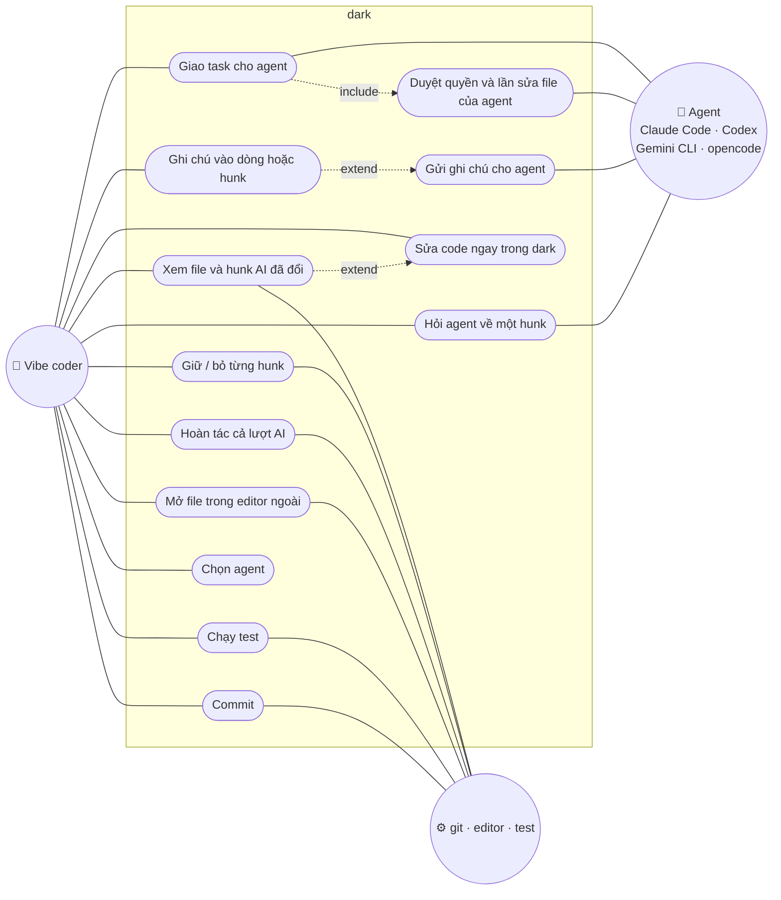

# dark — Danh sách tính năng

> Phiên bản: 0.2 (sau M0) · Cập nhật: 01/11/2026
> Liên quan: [ARCHITECTURE.md](ARCHITECTURE.md) · [PLANNING.md](PLANNING.md) · [SEQUENCE.md](SEQUENCE.md)

## 1. Phạm vi

dark chỉ phục vụ một vòng lặp:

**vibe với agent → review từng thay đổi → sửa nhanh hoặc góp ý ngược lại cho agent → hoàn tác khi cần**

Tính năng nào không phục vụ vòng lặp này thì bỏ hoặc giao cho công cụ khác (editor đầy đủ của người dùng, git, agent CLI). dark có editor gọn để sửa ngay khi review; việc sửa lớn vẫn mở editor ngoài bằng `e`.

| Mục tiêu | Cam kết |
|---|---|
| Chất lượng vibe | Ngang agent chính chủ: agent chạy đúng harness của nó qua ACP, dark chỉ thay giao diện |
| RAM khi review | Dưới 2 MB cho dark; `darkw` tính cả cửa sổ dưới 3 MB (cần đo ở M3) |
| Nền tảng | Windows là hạng nhất (có cửa sổ riêng `darkw`); Linux, macOS chạy bản terminal |

## 2. Tác nhân

| Tác nhân | Mô tả |
|---|---|
| **Vibe coder** | Người dùng chính: giao việc cho agent, review, giữ/bỏ thay đổi, sửa code, góp ý, commit |
| **Agent** | Claude Code, Codex CLI, Gemini CLI, opencode... chạy ngầm qua ACP, hoặc chạy riêng ở chế độ đi kèm |
| **Hệ thống cục bộ** | git, editor của người dùng, test runner |

## 3. Sơ đồ use case

## 4. Bảng tính năng

Ưu tiên: **P0** = bắt buộc cho bản ra mắt, **P1** = nên có khi ra mắt, **Sau** = sau khi ra mắt.
Cột "Milestone" theo [PLANNING.md](PLANNING.md). RAM tính cho process của dark; process con (git, agent) đo riêng.

### 4.1 Review

| ID | Tính năng | Mô tả | Ưu tiên | Milestone |
|---|---|---|---|---|
| R1 | Snapshot theo lượt AI | Ghi mốc git trước mỗi lượt agent; mặc định so với snapshot gần nhất, có thể chọn so với commit gần nhất | P0 | M1 |
| R2 | Danh sách file đã đổi | Tên file và trạng thái: chưa xem (·), đã xem (✓), bị xóa (−), file mới | P0 | M1 |
| R3 | Diff theo hunk | Hiển thị inline, dấu `+`/`−` kèm màu (không dựa vào màu riêng lẻ), tải lười theo file | P0 | M1 |
| R4 | Giữ / bỏ hunk | `a` giữ, `r` bỏ (hoàn tác hunk đó trên working tree); `n`/`N` hunk kế/trước | P0 | M1 |
| R5 | Hoàn tác cả lượt | `u` khôi phục về snapshot, có xác nhận | P0 | M1 |
| R6 | Mở editor ngoài | `e` mở đúng file và dòng bằng `$EDITOR` hoặc editor trong cấu hình | P0 | M1 |
| R7 | Độ rộng tab | Cấu hình được (mặc định 4 trong diff) | P1 | M1 |
| R8 | Ghi chú | `/` ghi chú vào dòng, khoảng dòng hoặc hunk; lưu trong `.dark/` | P0 | M2 |
| R9 | Gửi ghi chú cho agent | Gửi thẳng qua ACP; ở chế độ đi kèm thì xuất markdown có vị trí file:dòng (clipboard hoặc file) | P0 | M2 / M4 |
| R10 | Hỏi agent về hunk | `?` gửi câu hỏi kèm hunk cho agent đang dùng, hiện câu trả lời ngay dưới hunk | P1 | M5 |
| R11 | Tô màu cú pháp trong diff | Chỉ từ khóa, chuỗi, comment | Sau | — |

### 4.2 Sửa code ngay trong dark

Editor gọn kiểu nano/micro: không có chế độ (mode) như vim, phím quen thuộc, đủ để sửa nhanh khi review.

| ID | Tính năng | Mô tả | Ưu tiên | Milestone |
|---|---|---|---|---|
| E1 | Mở chế độ sửa | `Enter` tại hunk mở file ở chế độ sửa, con trỏ đúng dòng; `Esc` quay lại Review | P0 | M1 |
| E2 | Sửa cơ bản | Gõ, xóa, xuống dòng; mũi tên, Home/End, PgUp/PgDn, Ctrl-Home/End; con trỏ đi theo cụm ký tự (tiếng Việt có dấu, emoji); Tab theo kiểu thụt lề của file | P0 | M1 |
| E3 | Lưu | `Ctrl-S`; giữ kiểu xuống dòng LF/CRLF, BOM, quyền file; thoát khi chưa lưu thì hỏi | P0 | M1 |
| E4 | Hoàn tác / làm lại | `Ctrl-Z` / `Ctrl-Y`, lịch sử có giới hạn | P0 | M1 |
| E5 | Chọn chữ, clipboard | Shift + mũi tên; `Ctrl-C` / `Ctrl-X` / `Ctrl-V` với clipboard hệ thống (Windows; terminal hỗ trợ OSC 52) | P0 | M1 |
| E6 | Tìm, nhảy dòng | `Ctrl-F` tìm trong file, `Ctrl-G` nhảy tới dòng | P1 | M1 |
| E7 | Làm mới diff sau khi lưu | Danh sách hunk cập nhật ngay | P0 | M1 |
| E8 | An toàn khi sửa | File không phải UTF-8, nhị phân, quá lớn: chỉ xem, gợi ý `e`. File bị đổi từ bên ngoài khi đang sửa: báo và cho chọn, không ghi đè âm thầm | P0 | M1 |
| E9 | Hiện vùng thay đổi | Lề trái đánh dấu dòng khác so với snapshot ngay trong lúc sửa | P1 | M1 |
| E10 | Tô màu cú pháp trong editor | Chỉ từ khóa, chuỗi, comment | Sau | — |
| E11 | Thay thế hàng loạt | Tìm và thay trong file | Sau | — |

### 4.3 Vibe

| ID | Tính năng | Mô tả | Ưu tiên | Milestone |
|---|---|---|---|---|
| V1 | Chế độ đi kèm | Agent chạy ở cửa sổ khác; dark tự phát hiện thay đổi qua git và làm mới màn Review | P0 | M2 |
| V2 | Nhường màn hình | `v` trao terminal cho agent CLI (giao diện gốc), agent thoát thì dark quay lại màn Review; mở lại đúng phiên cũ | P1 | M2 |
| V3 | Chia màn hình | Mở agent ở khung bên cạnh nếu terminal hỗ trợ (Windows Terminal, tmux, WezTerm...) | P1 | M2 |
| V4 | ACP client | Chạy agent ngầm qua Agent Client Protocol (JSON-RPC qua stdio), không cần terminal | P0 | M4 |
| V5 | Agent hỗ trợ | Gemini CLI, opencode (ACP gốc); Codex (app-server hoặc `codex-acp`); Claude Code (`claude-agent-acp`, mặc định API key) | P0 | M4 |
| V6 | Màn Vibe | Ô nhập task, tin nhắn, kế hoạch, lệnh đang chạy, file đang sửa; log ghi ra đĩa | P0 | M4 |
| V7 | Duyệt quyền | Agent xin chạy lệnh hoặc sửa file thì dark hỏi người dùng | P0 | M4 |
| V8 | Sửa file đi qua dark | Nếu agent dùng cơ chế đọc/ghi file của client, mỗi lần sửa hiện hunk để duyệt trước khi ghi | P1 | M4 |
| V9 | Model API qua opencode | Dùng hơn 75 nhà cung cấp của opencode mà không cần dark tự gọi API | P1 | M4 |
| V10 | Agent tích hợp riêng | Gọi API trực tiếp qua `curl`, nhẹ nhất | Sau | — |

### 4.4 Quản lý agent

| ID | Tính năng | Mô tả | Ưu tiên | Milestone |
|---|---|---|---|---|
| A1 | Khởi động khi cần | Agent chỉ chạy khi vibe, không chạy sẵn lúc mở dark | P0 | M4 |
| A2 | Tự tắt khi rảnh | Tắt sau vài phút không dùng; mở lại thì tiếp tục đúng phiên | P0 | M4 |
| A3 | Một agent mỗi lúc | Đổi agent thì tắt agent cũ | P0 | M4 |
| A4 | Khởi động lại khi phình | Vượt ngưỡng RAM thì chờ hết lượt, tắt và mở lại, giữ hội thoại | P1 | M4 |
| A5 | Chế độ gọn | Khởi động agent với cấu hình tối thiểu (không MCP, không plugin thừa) nếu agent hỗ trợ | P1 | M4 |
| A6 | Hiện RAM của agent | Cộng cả cây process con, tách riêng với RAM của dark | P1 | M4 |
| A7 | Giới hạn cứng | `NODE_OPTIONS` cho agent Node; Job Object trên Windows. Tắt mặc định | Sau | — |

### 4.5 Chạy và commit

| ID | Tính năng | Mô tả | Ưu tiên | Milestone |
|---|---|---|---|---|
| T1 | Chạy test | `!` chạy lệnh trong cấu hình, chỉ hiện lỗi đầu tiên và vị trí | P1 | M2 |
| T2 | Commit | `c` commit phần đã giữ; agent gợi ý message nếu đang có agent | P1 | M2 / M5 |

### 4.6 Giao diện và vận hành

| ID | Tính năng | Mô tả | Ưu tiên | Milestone |
|---|---|---|---|---|
| U1 | Màn Review | Màn chính: danh sách file, diff, ghi chú; chuyển sang chế độ sửa bằng `Enter` | P0 | M1 |
| U2 | Màn Vibe | Xem V6 | P0 | M4 |
| U3 | Chọn agent | Popup khi bấm `m`; agent thiếu cài đặt hoặc thiếu key bị làm mờ | P0 | M4 |
| U4 | `darkw` | Cửa sổ Windows riêng (Win32 + GDI), không cần terminal | P0 | M3 |
| U5 | Bản terminal | `dark` chạy trong mọi terminal: PowerShell, mintty, WSL, VS Code, SSH | P0 | M0 ✓ |
| U6 | Tên cửa sổ | Ví dụ `dark — shop-api · 2/7 đã review` | P1 | M1 |
| U7 | `--debug` | Hiện RAM của dark | P1 | M0 ✓ |
| U8 | `--help`, `--version` | | P0 | M0 ✓ |
| U9 | Ngôn ngữ giao diện | Tiếng Anh, tiếng Việt | P1 | M5 |

### 4.7 An toàn

| ID | Tính năng | Mô tả | Ưu tiên | Milestone |
|---|---|---|---|---|
| S1 | Duyệt trước khi ghi | Patch hoặc lệnh của agent phải được duyệt (có thể tắt trong cấu hình) | P0 | M4 |
| S2 | API key | Chỉ đọc từ biến môi trường, không ghi vào cấu hình hay log | P0 | M4 |
| S3 | Đăng nhập chính chủ | Không dùng cách đăng nhập lách điều khoản của nhà cung cấp | P0 | M4 |

## 5. Phím tắt

| Phím | Màn | Tác dụng |
|---|---|---|
| `a` / `r` | Review | Giữ / bỏ hunk |
| `n` / `N` | Review | Hunk kế / trước |
| `u` | Review | Hoàn tác cả lượt AI về snapshot |
| `/` | Review | Ghi chú vào dòng hoặc hunk |
| `?` | Review | Hỏi agent về hunk đang xem |
| `Enter` | Review | Sửa file ngay trong dark, tại hunk đang chọn |
| `e` | Review | Mở file trong editor ngoài |
| `!` | Mọi màn | Chạy test |
| `c` | Review | Commit |
| `v` | Mọi màn | Vibe: mở màn Vibe (ACP) hoặc nhường màn hình cho agent CLI |
| `m` | Mọi màn | Chọn agent |
| `Tab` | Mọi màn | Chuyển màn Review / Vibe |
| `q` | Review, Vibe | Thoát |

**Trong chế độ sửa** các phím chữ dùng để gõ, nên phím tắt dùng `Ctrl`:

| Phím | Tác dụng |
|---|---|
| `Ctrl-S` | Lưu |
| `Ctrl-Z` / `Ctrl-Y` | Hoàn tác / làm lại |
| `Shift` + mũi tên | Chọn chữ |
| `Ctrl-C` / `Ctrl-X` / `Ctrl-V` | Copy / cắt / dán (trong chế độ sửa, `Ctrl-C` là copy, không thoát app) |
| `Ctrl-F` / `Ctrl-G` | Tìm / nhảy tới dòng |
| `Esc` | Quay lại màn Review (hỏi nếu chưa lưu) |

## 6. Ngoài phạm vi (cố tình không làm)

| Không làm | Thay bằng |
|---|---|
| Editor kiểu IDE (tự hoàn thành, đa con trỏ, nhiều tab, chế độ vim, plugin) | Editor gọn trong dark cho sửa nhanh; việc sửa lớn dùng `e` mở editor người dùng đang dùng |
| Tìm file kiểu fuzzy, cây thư mục | Danh sách file đã đổi là đủ cho review |
| Repo map (tree-sitter) | Agent tự tìm bằng công cụ của nó |
| LSP | Lệnh test/lint của project |
| Nhúng giao diện TUI của agent (PTY + terminal thu nhỏ) | Nhường màn hình, chia màn hình, hoặc ACP |
| Tự viết terminal emulator | `darkw` vẽ thẳng lưới chữ của dark, không làm terminal |
| Quản lý git đầy đủ (nhánh, rebase, log) | git, lazygit... |
| Diff side-by-side, hai chế độ giao diện | Chỉ diff inline, chỉ giao diện tối giản |
| Plugin, theme phức tạp, MCP client | — |

## 7. Mockup

Mockup trên canvas "Vibe Review TUI": https://claude.ai/artifact/5Sc1igNP8rkGNVWT9jBfkj (riêng tư, chỉ chủ sở hữu mở được trừ khi chia sẻ). Hàng "Bản tối giản" và "Chạy trong mintty" gần nhất với phạm vi hiện tại; hàng đầu tiên là bản đầy đủ cũ, giữ để tham khảo.
