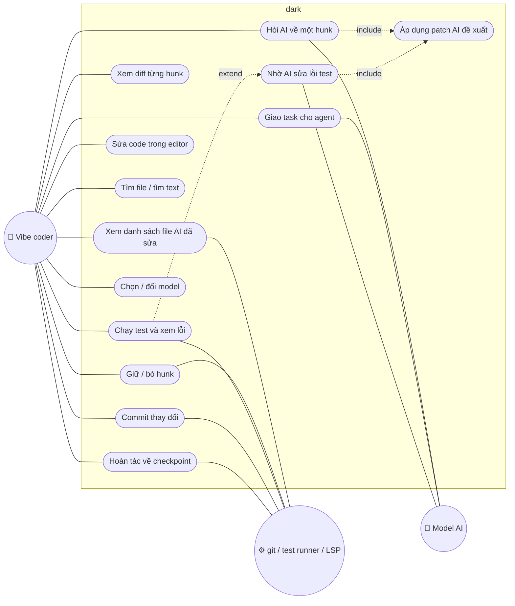

# dark — Danh sách tính năng MVP

> Phiên bản: 0.1 (pre-MVP) · Cập nhật: 01/11/2026
> Liên quan: [ARCHITECTURE.md](ARCHITECTURE.md) · [PLANNING.md](PLANNING.md) · [SEQUENCE.md](SEQUENCE.md)

## 1. Tác nhân

| Tác nhân | Mô tả |
|---|---|
| **Vibe coder** | Người dùng chính: giao việc cho AI, review và chấp nhận thay đổi, sửa nhanh, chạy test |
| **Model AI** | Model từ xa (Anthropic, Gemini, OpenAI-compatible) hoặc local (Ollama, LM Studio) |
| **Hệ thống cục bộ** | git, ripgrep, test runner, LSP chạy trên máy người dùng |

## 2. Sơ đồ use case

## 3. Bảng tính năng

Mức ưu tiên: **P0** = bắt buộc cho MVP, **P1** = nên có trong MVP, **Sau** = sau MVP.
Ảnh hưởng RAM tính cho process của app (process con không tính).

### 3.1 Review

| ID | Tính năng | Mô tả | Ưu tiên | RAM |
|---|---|---|---|---|
| R1 | Snapshot trước phiên AI | Tạo checkpoint git làm mốc so sánh | P0 | ~0 |
| R2 | Danh sách file đã đổi | Tên file + trạng thái đã xem (✓) / chưa (·) / bị xóa | P0 | Rất thấp |
| R3 | Diff theo hunk | Hiển thị inline, dòng thêm/xóa có dấu +/− (không chỉ dựa vào màu) | P0 | Thấp |
| R4 | Giữ / bỏ hunk | Phím `a` giữ, `r` bỏ; `n`/`N` hunk kế/trước | P0 | ~0 |
| R5 | Nhận xét AI ngay dưới dòng | AI chỉ ra lỗi, mức độ, đề xuất sửa | P0 | Thấp |
| R6 | Áp dụng patch AI | Xem trước diff, duyệt rồi mới ghi file | P0 | Thấp |
| R7 | Lọc file | Từ snapshot / từ commit gần nhất / chỉ file AI cảnh báo | P1 | ~0 |
| R8 | Diff side-by-side | Hai cột cũ/mới | Sau | Thấp |

### 3.2 AI và agent

| ID | Tính năng | Mô tả | Ưu tiên | RAM |
|---|---|---|---|---|
| A1 | Nhiều provider | Anthropic, Gemini native; OpenAI-compatible cho OpenAI, OpenRouter, DeepSeek, Ollama, LM Studio | P0 | Thấp |
| A2 | Stream câu trả lời | Đọc SSE qua `curl` | P0 | ~0 |
| A3 | Hỏi AI về hunk/file | Ô chat chỉ hiện khi bấm `?`, hỗ trợ `@file` thêm context | P0 | Thấp |
| A4 | Agent loop + công cụ | read, grep, glob, edit, run_command | P0 | Thấp |
| A5 | Edit engine chuẩn xác | Search/replace + khớp gần đúng + báo lỗi rõ | P0 | ~0 |
| A6 | Định dạng sửa theo họ model | search/replace hoặc apply_patch tùy model | P1 | ~0 |
| A7 | Repo map | tree-sitter, lazy, cache ra đĩa | P1 | 2–4 MB tạm thời |
| A8 | Quy tắc project | Đọc `AGENTS.md`, `CLAUDE.md` | P0 | ~0 |
| A9 | Compaction | Tóm tắt lượt cũ khi gần hết context | P1 | ~0 |
| A10 | Prompt caching | `cache_control` (Anthropic), cache tự động provider khác | P1 | ~0 |
| A11 | Tham số đầy đủ | reasoning/thinking, max_tokens, không cắt output | P0 | ~0 |
| A12 | Ngân sách chi phí | Giới hạn $/ngày, chỉ cảnh báo khi vượt | P1 | ~0 |
| A13 | So sánh 2 model | Cùng câu hỏi, hai câu trả lời | Sau | Thấp |
| A14 | MCP client | Kết nối MCP server ngoài | Sau | Thấp |

### 3.3 Kiểm tra (verify)

| ID | Tính năng | Mô tả | Ưu tiên | RAM |
|---|---|---|---|---|
| V1 | Chạy lệnh test/build | Bắt stdout/stderr, hiện lỗi; phím `!` | P0 | Thấp |
| V2 | Nhảy tới vị trí lỗi | Từ output test mở đúng file:dòng | P1 | ~0 |
| V3 | Vòng kiểm tra tự động | Sau mỗi lần AI sửa: lint/typecheck/test, đưa lỗi lại cho model | P0 | ~0 |
| V4 | Báo lỗi qua LSP | Lazy, tự tắt khi rảnh, có thể tắt hẳn | P1 | ~0 (process riêng) |

### 3.4 Editor và điều hướng

| ID | Tính năng | Mô tả | Ưu tiên | RAM |
|---|---|---|---|---|
| E1 | Mở/sửa/lưu file | Rope buffer, undo/redo, `ctrl-s` | P0 | Thấp |
| E2 | Tìm và thay | Trong file | P0 | ~0 |
| E3 | Tìm file fuzzy | `ctrl-p` | P0 | Thấp |
| E4 | Tìm text toàn project | Gọi ripgrep | P1 | ~0 |
| E5 | Tô màu cú pháp đơn giản | Từ khóa, chuỗi, comment; chỉ dòng đang hiển thị | P1 | ~0 |
| E6 | Phím tắt kiểu Vim/Helix | | Sau | ~0 |

### 3.5 Git và an toàn

| ID | Tính năng | Mô tả | Ưu tiên | RAM |
|---|---|---|---|---|
| G1 | Checkpoint trước mỗi lượt AI | Hoàn tác an toàn | P0 | ~0 |
| G2 | Commit | Viết message hoặc nhờ AI gợi ý từ diff; phím `c` | P1 | ~0 |
| G3 | Patch cần duyệt | Mặc định bật | P0 | ~0 |
| G4 | API key từ biến môi trường | Không lưu key dạng chữ | P0 | ~0 |

### 3.6 Giao diện

| ID | Tính năng | Mô tả | Ưu tiên | RAM |
|---|---|---|---|---|
| U1 | Màn Review | Màn hình chính | P0 | Thấp |
| U2 | Màn Edit + Run | | P0 | Thấp |
| U3 | Màn chọn model | Danh sách model, model thiếu key bị làm mờ | P0 | ~0 |
| U4 | Hai chế độ hiển thị | **Đầy đủ** (thanh trên, số dòng, panel AI, token, RSS) và **tối giản** (chỉ file, diff, 3 phím) | P1 | ~0 |
| U5 | Chế độ `--debug` | Hiện RSS, token, chi phí | P1 | ~0 |

## 4. Phím tắt (MVP)

| Phím | Màn | Tác dụng |
|---|---|---|
| `a` / `r` | Review | Giữ / bỏ hunk |
| `n` / `N` | Review | Hunk kế / trước |
| `e` | Review | Sửa hunk trong editor |
| `?` | Mọi màn | Hỏi AI |
| `p` | Review | Áp dụng patch AI đề xuất |
| `ctrl-p` | Mọi màn | Tìm file |
| `ctrl-s` | Edit | Lưu |
| `!` | Mọi màn | Chạy test/lệnh |
| `m` | Mọi màn | Chọn model |
| `c` | Review | Commit |
| `tab` | Mọi màn | Chuyển pane |

## 5. Ngoài phạm vi MVP

- Hệ thống plugin, theme phức tạp, file tree đồ họa.
- Terminal PTY nhúng đầy đủ (chỉ bắt output lệnh).
- GUI, bản web.
- Agent chạy nhiều bước hoàn toàn tự động không cần duyệt (chỉ khi người dùng tắt duyệt trong config).

## 6. Mockup giao diện

Mockup 3 màn (bản đầy đủ và bản tối giản) nằm trên canvas "Vibe Review TUI":
https://claude.ai/artifact/5Sc1igNP8rkGNVWT9jBfkj (riêng tư, chỉ chủ sở hữu mở được trừ khi chia sẻ).
