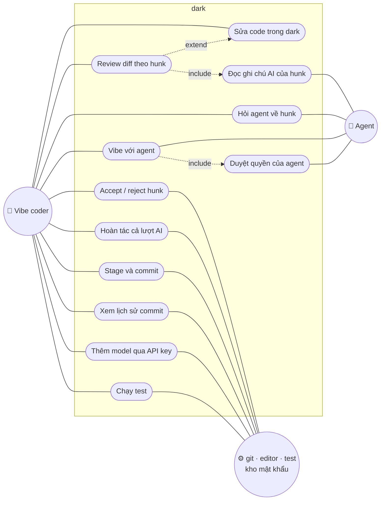

# dark — Danh sách tính năng

> Phiên bản: 0.3 · Cập nhật: 01/11/2026
> Liên quan: [UI_SPEC.md](UI_SPEC.md) · [PLANNING.md](PLANNING.md) · [ARCHITECTURE.md](ARCHITECTURE.md) · [SEQUENCE.md](SEQUENCE.md)

## 1. Phạm vi

dark phục vụ một vòng lặp:

**vibe với agent → review từng hunk → giữ / bỏ / sửa ngay → góp ý ngược lại cho agent → commit hoặc hoàn tác**

Giao diện gồm 7 tab trên một thanh ngang: **1 Review · 2 Edit · 3 Vibe · 4 Git commit · 5 Models · 6 View · 7 Help**. Bố cục, màu và phím chi tiết của từng tab nằm trong [UI_SPEC.md](UI_SPEC.md) (ảnh mẫu ở [`docs/ui/`](ui/)).

| Mục tiêu | Cam kết |
|---|---|
| Chất lượng vibe | Ngang agent chính chủ: agent chạy đúng harness của nó (qua CLI hoặc ACP), dark chỉ thay giao diện |
| RAM của dark | Review < 2 MB; sửa file lớn < 4 MB; vibe 1 agent < 4 MB; 6 agent < 10 MB (không tính agent) |
| Nền tảng | Windows hạng nhất (có cửa sổ riêng `darkw`); Linux, macOS chạy bản terminal |

## 2. Tác nhân

| Tác nhân | Mô tả |
|---|---|
| **Vibe coder** | Người dùng chính: giao việc cho agent, review, giữ/bỏ/sửa, góp ý, commit |
| **Agent** | Claude Code, Codex CLI, Gemini CLI, opencode... (gọi CLI hoặc chạy ngầm qua ACP); model qua API key |
| **Hệ thống cục bộ** | git, editor ngoài, test runner, kho mật khẩu của hệ điều hành |

## 3. Sơ đồ use case

## 4. Bảng tính năng

Giai đoạn và milestone theo [PLANNING.md](PLANNING.md): **GĐ1 = v0.1 (M1–M3)**, **GĐ2 = v0.2 (M4–M6)**, **GĐ3 = v1.x (M7–M9)**.
RAM là phần dark tốn thêm (ước tính), chưa tính agent và cửa sổ terminal.

### 4.1 Chung

| ID | Tính năng | Mô tả | Milestone | RAM thêm |
|---|---|---|---|---|
| C1 | Thanh tab 1–7 | `1`–`7` đổi tab, `Alt-1`…`Alt-7` khi đang gõ chữ; 6 View và 7 Help hiện "Coming soon" | M1 | ~0 |
| C2 | Theme theo Hunk | Bảng màu GitHub Dark Default trong một module duy nhất; viền `accent` cho khung active | M1 | ~0 |
| C3 | Thanh trạng thái | Tên chế độ, gợi ý phím, thông tin ngữ cảnh | M1 | ~0 |
| C4 | Màn hẹp | Rút gọn nhãn tab; diff tự về 1 cột; thông báo khi < 80×24 | M1 | ~0 |
| C5 | Snapshot theo lượt AI | Mốc git riêng trước mỗi lượt agent | M1 | ~0 |
| C6 | Tự làm mới | Phát hiện file đổi khi agent chạy ở cửa sổ khác | M3 | ~0 |
| C7 | `!` chạy test | Hiện lỗi đầu tiên và vị trí | M3 | < 0,2 MB |
| C8 | `darkw` | Cửa sổ Windows riêng (Win32 + GDI), gõ tiếng Việt, clipboard, DPI | M4 | 0,5–2 MB |
| C9 | Song ngữ | Tiếng Anh, tiếng Việt | M6 | ~0 |
| C10 | Tab View, Help | Nội dung thật | M9 | ~0 |

### 4.2 Tab 1 · Review

| ID | Tính năng | Mô tả | Milestone | RAM thêm |
|---|---|---|---|---|
| R1 | Panel danh sách thay đổi | Kiểu git panel của Zed: nhóm Staged / Changes / Untracked, chữ trạng thái màu, `+N −N`, `✓` đã xem; `l` ẩn/hiện | M1 | < 0,2 MB |
| R2 | Khung diff 80% | `r` ẩn/hiện; 2 cột cũ/mới, nhấn mạnh chữ đổi trong dòng; tự về 1 cột khi hẹp; `v` đổi split/unified | M1 | 0,5–1 MB |
| R3 | Accept / reject hunk | `a` giữ, `x` bỏ (hoàn tác hunk trên working tree) | M1 | ~0 |
| R4 | Điều hướng hunk | `n` / `N`, tự sang file kế | M1 | ~0 |
| R5 | Hoàn tác cả lượt | `u` về snapshot, có xác nhận | M1 | ~0 |
| R6 | Mở editor ngoài | `e` mở đúng file và dòng | M1 | ~0 |
| R7 | Sửa hunk tại chỗ | `Enter` mở editor của dark tại dòng của hunk | M2 | xem E2 |
| R8 | Stage và commit từ panel | `Space` stage/unstage file, `s` stage tất cả, ô commit message, `c` commit; `d` bỏ thay đổi file (có xác nhận) | M3 | < 0,2 MB |
| R9 | Ghi chú AI mỗi hunk | Tóm tắt 1–3 câu và cảnh báo, do agent viết qua skill dark-notes, lưu `.dark/notes/`, không ghi vào code; cache theo nội dung hunk | M5 | < 0,2 MB |
| R10 | Hỏi agent về hunk | `?` chỉ gửi hunk và vài dòng xung quanh | M5 | < 0,2 MB |
| R11 | Ghi chú của người dùng | `/` ghi chú dòng/hunk, gửi thẳng cho agent (skill dark-feedback) | M5 | < 0,2 MB |

### 4.3 Tab 2 · Edit

| ID | Tính năng | Mô tả | Milestone | RAM thêm |
|---|---|---|---|---|
| E1 | Cây thư mục | Tải dần, bỏ qua `.gitignore`, đánh dấu file/thư mục đã đổi; `Ctrl-B` ẩn/hiện | M2 | 0,1–1 MB |
| E2 | Editor gọn | Gõ, xóa, di chuyển theo cụm ký tự (tiếng Việt, emoji); Tab theo kiểu thụt lề của file | M2 | 1–2 MB (file 10.000 dòng) |
| E3 | Lưu an toàn | `Ctrl-S`; giữ LF/CRLF, BOM, quyền file; ghi file tạm rồi đổi tên; hỏi khi thoát chưa lưu | M2 | ~0 |
| E4 | Hoàn tác / làm lại | `Ctrl-Z` / `Ctrl-Y`, lịch sử có giới hạn | M2 | trong E2 |
| E5 | Chọn chữ, clipboard | `Shift` + mũi tên; `Ctrl-C` / `Ctrl-X` / `Ctrl-V` với clipboard hệ thống (Windows; OSC 52) | M2 | ~0 |
| E6 | Tìm, nhảy dòng | `Ctrl-F`, `Ctrl-G` | M2 | ~0 |
| E7 | Vạch thay đổi | Lề trái đánh dấu dòng thêm/sửa/xóa so với snapshot | M2 | ~0 |
| E8 | An toàn khi sửa | File nhị phân, không UTF-8, quá lớn: chỉ xem. File bị đổi từ bên ngoài: báo, không ghi đè âm thầm | M2 | ~0 |
| E9 | Tô màu cú pháp | Từ khóa, chuỗi, chú thích, hàm (cả trong diff) | M9 | 0,5–2 MB |
| E10 | Tìm và thay hàng loạt | | M9 | ~0 |

### 4.4 Tab 3 · Vibe

| ID | Tính năng | Mô tả | Milestone | RAM thêm |
|---|---|---|---|---|
| V1 | Phát hiện agent | Claude Code, Codex CLI, Gemini CLI, opencode đã cài hay chưa | M3 | ~0 |
| V2 | Gọi agent CLI | Mở giao diện gốc của agent (nhường hoặc chia màn hình), xong về Review | M3 | ~0 |
| V3 | Dải 6 ô agent | Hiển thị đủ 6 ô; trước M7 chỉ dùng ô 1 | M3 | ~0 |
| V4 | Agent chạy trong dark qua ACP | Codex (app-server), Gemini CLI, opencode, Claude Code (API key); hội thoại, kế hoạch, lệnh, file | M5 | 0,5–1 MB |
| V5 | Duyệt quyền | Agent xin chạy lệnh hoặc sửa file thì hỏi người dùng | M5 | ~0 |
| V6 | Sửa file đi qua dark | Nếu agent dùng cơ chế ghi file của client, mỗi lần sửa được duyệt theo hunk | M5 | ~0 |
| V7 | Vòng đời agent | Bật khi cần, tắt khi rảnh, khởi động lại khi phình RAM mà giữ phiên; hiện RAM của agent | M5 | ~0 |
| V8 | Model qua API key | Chọn model đã thêm ở tab Models, chạy qua opencode | M6 | ~0 |
| V9 | Tối đa 6 agent cùng lúc | Mỗi agent một git worktree, không sửa đè nhau | M7 | +0,5–1 MB mỗi agent |
| V10 | Agent riêng của dark | Gọi API trực tiếp, nhẹ nhất | M9 | 2–3 MB |

### 4.5 Tab 4 · Git commit

| ID | Tính năng | Mô tả | Milestone | RAM thêm |
|---|---|---|---|---|
| G1 | Lịch sử commit | hash, message, nhãn nhánh/tag, tác giả, thời gian tương đối; tải dần ~200 commit | M3 | 0,2–0,5 MB |
| G2 | Cây nhánh | Lấy từ `git log --graph`, tô màu từng nhánh | M3 | trong G1 |
| G3 | Chi tiết commit | Message, tác giả, parent, danh sách file `+/−` | M3 | < 0,1 MB |
| G4 | Diff của commit | `Enter` mở bằng khung diff của Review, chỉ đọc | M3 | dùng lại R2 |
| G5 | Tìm commit, xem nhánh khác | `/` tìm; `b` chọn nhánh để xem (không checkout) | M3 | ~0 |

### 4.6 Tab 5 · Models

| ID | Tính năng | Mô tả | Milestone | RAM thêm |
|---|---|---|---|---|
| P1 | Danh sách nhà cung cấp | Anthropic, OpenAI, Gemini, OpenRouter, DeepSeek, Ollama, LM Studio, OpenAI-compatible tùy chỉnh | M6 | ~0 |
| P2 | Nhập API key | Hiển thị dạng `••••`, lưu trong Windows Credential Manager; không ghi ra file hay log | M6 | ~0 |
| P3 | Kiểm tra kết nối | Báo thành công kèm độ trễ, hoặc lý do lỗi | M6 | ~0 |
| P4 | Model mặc định, Base URL | Base URL chỉ cho OpenAI-compatible | M6 | ~0 |
| P5 | Kho mật khẩu macOS, Linux | Keychain, Secret Service | M9 | ~0 |

### 4.7 Skill và tiết kiệm token

| ID | Tính năng | Mô tả | Milestone |
|---|---|---|---|
| K1 | Skill dark-notes | Agent tự ghi tóm tắt từng hunk cuối mỗi lượt, không phải gửi lại diff | M5 |
| K2 | Skill dark-feedback | Agent đọc ghi chú của người dùng và sửa đúng vị trí | M5 |
| K3 | Cài skill có hỏi trước | Liệt kê, bật/tắt, gỡ sạch; tên có tiền tố `dark-`; không ghi đè skill của người dùng | M5 |
| K4 | Chọn model theo loại việc | Model rẻ cho tóm tắt, commit message; model mạnh cho code | M8 |
| K5 | Đồng hồ token và chi phí | Mỗi lượt, trong tab Vibe | M8 |
| K6 | Thư viện skill tùy chọn | verify-before-done, trả lời gọn...; mỗi skill phải qua bộ eval | M8 |
| K7 | Tóm tắt hội thoại dài | Khi gần hết context | M8 |

### 4.8 An toàn

| ID | Tính năng | Mô tả | Milestone |
|---|---|---|---|
| S1 | Duyệt trước khi ghi | Lệnh và lần sửa file của agent phải được duyệt (tắt được trong cấu hình) | M5 |
| S2 | API key | Chỉ từ biến môi trường hoặc kho mật khẩu hệ điều hành; không bao giờ ghi ra file hay log | M6 |
| S3 | Đăng nhập chính chủ | Không dùng cách đăng nhập lách điều khoản; gói Claude Pro/Max dùng Claude Code chính chủ | M3 |
| S4 | Thao tác nguy hiểm có xác nhận | Hoàn tác cả lượt, bỏ thay đổi file, xóa key | M1 |

## 5. Phím tắt chính

Chi tiết theo từng tab: [UI_SPEC.md](UI_SPEC.md).

| Phím | Ở đâu | Tác dụng |
|---|---|---|
| `1`…`7` / `Alt-1`…`Alt-7` | Mọi nơi / khi đang gõ chữ | Đổi tab |
| `Tab` | Mọi nơi | Đổi khung active |
| `l` / `r` | Review | Ẩn/hiện panel danh sách / khung diff |
| `n` / `N` | Review | Hunk kế / trước |
| `a` / `x` | Review | Accept / reject hunk |
| `Enter` | Review | Sửa hunk trong dark |
| `?` / `/` | Review | Hỏi agent / ghi chú cho agent (M5) |
| `u` | Review | Hoàn tác cả lượt AI |
| `e` | Review | Mở editor ngoài |
| `Space` / `s` / `c` | Review (panel) | Stage file / stage tất cả / commit |
| `Ctrl-S`, `Ctrl-Z`, `Ctrl-Y`, `Ctrl-F`, `Ctrl-G`, `Ctrl-B` | Edit | Lưu, hoàn tác, làm lại, tìm, nhảy dòng, cây thư mục |
| `Esc` | Edit | Về màn trước (hỏi nếu chưa lưu) |
| `Ctrl-1`…`Ctrl-6` | Vibe | Đổi ô agent |
| `!` | Mọi nơi | Chạy test |
| `q` | Ngoài chế độ gõ chữ | Thoát |

## 6. Ngoài phạm vi (cố tình không làm)

| Không làm | Thay bằng |
|---|---|
| Editor kiểu IDE: tự hoàn thành, đa con trỏ, nhiều tab file, chế độ vim, plugin | Editor gọn trong dark; việc lớn dùng `e` mở editor ngoài |
| LSP, repo map (tree-sitter) | Lệnh test/lint; agent tự tìm ngữ cảnh |
| Nhúng giao diện TUI của agent vào trong dark (PTY + terminal thu nhỏ) | Nhường/chia màn hình, hoặc ACP |
| Tự viết terminal emulator | `darkw` chỉ vẽ lưới chữ của dark |
| Thao tác git nâng cao: rebase, merge, đổi nhánh, push | git hoặc lazygit; tab Git chỉ xem lịch sử và commit |
| Theme tùy biến | Một theme theo Hunk (có thể thêm sau v1.x) |
