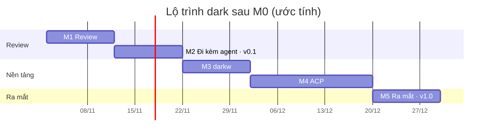

# dark — Kế hoạch phát triển

> Phiên bản: 0.2 (sau M0) · Cập nhật: 01/11/2026
> Liên quan: [ARCHITECTURE.md](ARCHITECTURE.md) · [FEATURES.md](FEATURES.md) · [SEQUENCE.md](SEQUENCE.md) · [DEVELOPMENT.md](DEVELOPMENT.md)

## 1. Mục tiêu bản ra mắt

- Review mọi thay đổi agent tạo ra: theo file, theo hunk, giữ/bỏ, hoàn tác cả lượt, ghi chú gửi lại agent.
- Vibe với **Claude Code, Codex, Gemini CLI, opencode** ngay trong dark qua ACP, chất lượng ngang agent chính chủ.
- Trên Windows, `darkw` chạy cửa sổ riêng không cần terminal.
- RAM của dark dưới ngân sách ở mọi kịch bản test ([ARCHITECTURE.md §6](ARCHITECTURE.md#6-ngân-sách-ram)); RAM của agent đo và báo riêng.
- Windows (máy phát triển chính), Linux (musl), macOS (bản terminal).

## 2. Nguyên tắc làm việc

1. **Bài test RAM ở mọi milestone**, đo bản release. Vượt ngân sách thì dừng thêm tính năng, xử lý trước. Không đổi ngưỡng hay số đo để báo đạt.
2. **Mỗi milestone kết thúc bằng một bản dùng được thật.** Từ M1, dùng chính dark để review code của các milestone sau.
3. **Lập kế hoạch và chờ duyệt trước khi code** mỗi milestone (xem [AGENT_WORKFLOW.md](AGENT_WORKFLOW.md)).
4. Dependency mới phải có lý do trong kế hoạch đã duyệt và đi qua bài test RAM.

## 3. Lộ trình

Thời gian là ước tính cho một người làm cùng agent, cần điều chỉnh theo thực tế.

| Milestone | Nội dung | Ước tính | Tính năng ([FEATURES.md](FEATURES.md)) |
|---|---|---|---|
| **M0** Khung ✓ | Event loop, renderer, ba màn trống, đo RAM, runner kiểm chứng | xong (tag `m0`) | U5, U7, U8 |
| **M1** Review | Snapshot, diff theo hunk, giữ/bỏ, hoàn tác cả lượt, mở editor, tên cửa sổ | 1–2 tuần | R1–R7, U1, U6 |
| **M2** Đi kèm agent | Ghi chú, xuất cho agent, phát hiện thay đổi, nhường/chia màn hình, chạy test, commit | 1–2 tuần | R8, R9 (xuất markdown), V1–V3, T1, T2 |
| **M3** `darkw` | Bản thử đo RAM, rồi cửa sổ Win32 + GDI, bộ gõ tiếng Việt, clipboard, DPI | 1–2 tuần | U4 |
| **M4** ACP | ACP client, màn Vibe, duyệt quyền, sửa file qua dark, vòng đời agent | 2–3 tuần | V4–V9, A1–A6, U2, U3, S1–S3, R9 (qua ACP) |
| **M5** Ra mắt | Hỏi agent về hunk, gợi ý commit, ngôn ngữ giao diện, đóng gói, benchmark công khai, README | 1–2 tuần | R10, T2, U9 |

**Tổng ước tính:** khoảng 7–11 tuần sau M0.

**Phát hành:**
- **v0.1 (sau M2):** bản dùng thử cho nhóm nhỏ và cộng đồng dev Việt để lấy phản hồi. Chưa đăng Show HN.
- **v1.0 (sau M5):** ra mắt chính thức (Show HN, r/rust...), khi đã có ACP, `darkw` và số đo so sánh sau M1.

## 4. Tiêu chí hoàn thành

### M0 — Khung dự án ✓ (tag `m0`)
- [x] Binary release dưới 3 MB: Windows 212.480 byte, Linux musl 537.464 byte.
- [x] Ba màn trống, chuyển bằng `1`/`2`/`3`, thoát sạch bằng `q`/`Ctrl-C`, phục hồi terminal sau panic.
- [x] RAM idle dưới 2.000.000 byte: Windows 557.056 byte (private working set), Linux musl 524.288 byte (VmRSS).
- [x] fmt, Clippy, test debug/release đạt trên Windows và WSL musl; kiểm tra terminal thật 10/10 (Windows), 6/6 (WSL).
- [x] Cắt chữ theo grapheme và độ rộng cột; `--help`, `--version`, lỗi tham số rõ ràng; script kiểm chứng được commit.
- Còn mở: macOS mới qua `cargo check`; bản GNU trên Linux vượt 2 MB do glibc dùng chung (đã chọn musl cho bản phát hành).

Output và số đo: [M0_VERIFICATION.md](M0_VERIFICATION.md).

### M1 — Review
- [ ] Trên một repo thật: tạo snapshot, hiện đúng danh sách file đổi so với snapshot (thêm, sửa, xóa, file mới).
- [ ] Diff theo hunk; `a`/`r` giữ/bỏ; sau khi bỏ, `git diff` khớp đúng phần còn lại.
- [ ] `u` hoàn tác cả lượt về snapshot, có xác nhận; không làm hỏng index hay nhánh của người dùng.
- [ ] `e` mở đúng file và dòng trong editor; độ rộng tab cấu hình được; tên cửa sổ hiện project và tiến độ.
- [ ] Repo không phải git, file nhị phân, file rất lớn, tên file Unicode: báo rõ, không crash.
- [ ] RAM khi review repo mẫu (~30 file, ~3.000 dòng đổi) dưới 2.000.000 byte trên Windows và Linux musl.
- [ ] Chạy lại `tests/bench/compare-review-tools.py`; cập nhật bảng so sánh trong ARCHITECTURE §6.2.

### M2 — Đi kèm agent (v0.1)
- [ ] `/` ghi chú dòng, khoảng dòng, hunk; xuất markdown có vị trí file:dòng ra clipboard hoặc file.
- [ ] Agent chạy ở cửa sổ khác sửa file: dark tự làm mới danh sách mà không cần mở lại.
- [ ] `v` nhường màn hình cho agent CLI cấu hình sẵn (Codex, Claude Code, Gemini CLI), quay lại màn Review khi agent thoát.
- [ ] Chia màn hình trong Windows Terminal và tmux; terminal không hỗ trợ thì mở cửa sổ riêng.
- [ ] `!` chạy test, hiện lỗi đầu tiên và vị trí; `c` commit phần đã giữ.
- [ ] Kiểm tra trong PowerShell, mintty, WSL, terminal của VS Code.

### M3 — `darkw`
- [ ] **Bản thử (1–2 ngày, nhánh riêng):** cửa sổ Win32 + GDI, ba màn, resize, gõ tiếng Việt; RAM idle dưới 3.000.000 byte, không có conhost/OpenConsole đi kèm. Không đạt thì báo lại để quyết định trước khi làm tiếp.
- [ ] `darkw.exe` chạy màn Review đầy đủ như bản terminal.
- [ ] Gõ tiếng Việt bằng Unikey, EVKey và bộ gõ Windows; copy/paste; DPI cao; icon, tên cửa sổ.
- [ ] Process con không chớp cửa sổ console.

### M4 — ACP
- [ ] Phương án chờ đồng thời console và pipe trên Windows được chốt, kèm số đo RAM.
- [ ] Vibe được với Gemini CLI và opencode (ACP gốc), Codex (app-server hoặc `codex-acp`), Claude Code (`claude-agent-acp` với API key).
- [ ] Màn Vibe hiện tin nhắn, kế hoạch, lệnh, file; log ghi ra đĩa; duyệt quyền chạy lệnh và sửa file.
- [ ] Agent dùng cơ chế đọc/ghi file của client thì mỗi lần sửa được duyệt theo hunk trước khi ghi.
- [ ] Ghi chú gửi thẳng cho agent qua ACP.
- [ ] Vòng đời agent: bật khi vibe, tắt khi rảnh, một agent mỗi lúc, khởi động lại khi phình mà giữ phiên; hiện RAM của agent.
- [ ] RAM của dark khi đang nhận luồng ACP dưới 4.000.000 byte (không tính agent), đo bằng agent giả lập trong test.
- [ ] Kiểm tra lại điều khoản gói thuê bao của từng agent; ghi kết quả vào ARCHITECTURE §8.

### M5 — Ra mắt (v1.0)
- [ ] `?` hỏi agent về hunk; agent gợi ý commit message.
- [ ] Giao diện tiếng Anh và tiếng Việt.
- [ ] Đóng gói: winget hoặc scoop, Homebrew, `cargo install`, file tải sẵn (Windows, Linux musl, macOS).
- [ ] Benchmark công khai chạy trong CI; README có ảnh động, bảng số đo, script kiểm chứng.
- [ ] Tên chính thức được chốt và kiểm tra trên crates.io, GitHub, winget, scoop, Homebrew, tên miền.

## 5. Quyết định còn mở

| Câu hỏi | Lựa chọn | Thời điểm |
|---|---|---|
| Snapshot lưu thế nào | Ref riêng `refs/dark/...` / stash / commit tạm | Kế hoạch M1 |
| Chờ console + pipe trên Windows | Luồng đọc pipe nhỏ / overlapped I/O một luồng | Kế hoạch M4 |
| SDK Rust của ACP hay tự viết JSON-RPC | Theo dependency và số đo RAM | Kế hoạch M4 |
| Codex qua app-server hay `codex-acp` | App-server nhẹ hơn (không Node) / ACP thống nhất | Kế hoạch M4 |
| Trên Windows mặc định mở `darkw` hay bản terminal | Theo kết quả M3 | Cuối M3 |
| Tên chính thức | Để sau | Trước M5 |
| Agent tích hợp riêng (gọi API qua curl) | Làm sau ra mắt nếu người dùng cần | Sau v1.0 |

Đã chốt ở M0: renderer tự viết (không dùng ratatui); musl cho bản phát hành Linux.

## 6. Rủi ro cần theo dõi

Bảng đầy đủ: [ARCHITECTURE.md §9](ARCHITECTURE.md#9-rủi-ro-và-cách-giảm). Ba rủi ro chính:
1. **Đối thủ đã có phần review** → giữ khác biệt ở cả vòng lặp vibe–review–góp ý–hoàn tác, ra v0.1 sớm để lấy phản hồi.
2. **`darkw` hoặc Windows pipe phức tạp hơn dự kiến** → bản thử và số đo trước khi cam kết; bản terminal luôn là dự phòng.
3. **RAM phình dần** → bài test RAM và benchmark so sánh ở mọi milestone.
