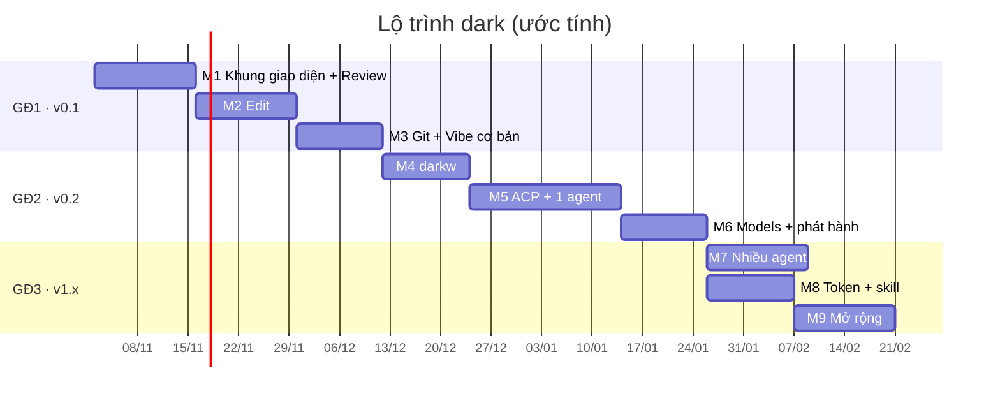

# dark — Kế hoạch phát triển

> Phiên bản: 0.3 · Cập nhật: 01/11/2026
> Liên quan: [FEATURES.md](FEATURES.md) · [UI_SPEC.md](UI_SPEC.md) · [ARCHITECTURE.md](ARCHITECTURE.md) · [SEQUENCE.md](SEQUENCE.md) · [DEVELOPMENT.md](DEVELOPMENT.md) · [AGENT_WORKFLOW.md](AGENT_WORKFLOW.md)

## 1. Tổng quan

| Giai đoạn | Phiên bản | Milestone | Mục tiêu | Ước tính |
|---|---|---|---|---|
| **GĐ0** ✓ | — | M0 | Khung ứng dụng, đo RAM | Xong (tag `m0`) |
| **GĐ1** | **v0.1 (MVP)** | M1–M3 | Mọi thứ không cần AI chạy bên trong dark: Review, Edit, Git, gọi agent CLI đã cài | 5–7 tuần |
| **GĐ2** | **v0.2** | M4–M6 | AI bên trong dark: 1 agent qua ACP, ghi chú AI cho hunk, Models với API key, cửa sổ `darkw` | 5–7 tuần |
| **GĐ3** | **v1.x** | M7–M9 | Nhiều agent cùng lúc, tiết kiệm token, agent riêng, View/Help | 4–6 tuần trở lên |

**Tổng:** khoảng 14–20 tuần. Ước tính cho một người làm cùng agent, chỉnh theo thực tế.

## 2. Nguyên tắc làm việc

1. **Giao diện theo [UI_SPEC.md](UI_SPEC.md) và ảnh trong [`docs/ui/`](ui/).** Màu chỉ lấy từ module theme. Khác ảnh thì phải ghi lý do trong báo cáo.
2. **Bài test RAM ở mọi milestone**, đo bản release. Vượt ngân sách thì dừng thêm tính năng, xử lý trước. Không đổi ngưỡng hay số đo để báo đạt.
3. **Mỗi milestone kết thúc bằng một bản dùng được.** Từ M1, dùng chính dark để review code của các milestone sau.
4. **Lập kế hoạch và chờ duyệt trước khi code** mỗi milestone. Dependency mới phải có lý do và qua bài test RAM.
5. **Không làm trước tính năng của milestone sau.**

## 3. Chi tiết từng milestone

Mã tính năng (C, R, E, V, G, P, K, S) theo [FEATURES.md](FEATURES.md).

| Milestone | Nội dung | Bạn dùng được gì | RAM mục tiêu của dark | Ước tính | Cần xong trước |
|---|---|---|---|---|---|
| **M1** Khung giao diện + Review | C1–C5, R1–R6, S4: thanh tab 1–7 (6, 7 Coming soon), theme Hunk, khung active, snapshot, panel danh sách (`l`), diff 2 cột (`r`), accept/reject (`a`/`x`), hoàn tác cả lượt (`u`), editor ngoài (`e`), tên cửa sổ | Review code agent viết, giữ/bỏ từng hunk | Review diff 30 file < 2 MB | 2 tuần | M0 |
| **M2** Edit | E1–E8, R7: cây thư mục, editor gọn, lưu an toàn, sửa hunk từ Review (`Enter`), `Alt-1…7` | Sửa code ngay trong dark | Sửa file 10.000 dòng < 4 MB | 2 tuần | M1 |
| **M3** Git + Vibe cơ bản → **v0.1** | R8, G1–G5, V1–V3, C6, C7, S3: stage/commit từ panel, lịch sử + cây nhánh + diff commit, phát hiện và gọi agent CLI, tự làm mới, chạy test | **Bản dùng thử đầu tiên** | Lịch sử 200 commit < 0,5 MB thêm | 1,5–2 tuần | M2 |
| **M4** `darkw` | C8: bản thử 1–2 ngày để đo, rồi cửa sổ Windows riêng | Nhấp đúp mở dark, không cần terminal | `darkw` idle < 3 MB tính cả cửa sổ | 1,5–2 tuần | M3 |
| **M5** ACP + 1 agent | V4–V7, R9–R11, K1–K3, S1: ACP client, 4 agent, duyệt quyền, sửa file qua dark, vòng đời agent, skill dark-notes/dark-feedback, ghi chú AI mỗi hunk, hỏi về hunk | Vibe và review trong một app | Đang vibe < 4 MB (không tính agent) | 3 tuần | M3 |
| **M6** Models + phát hành → **v0.2** | P1–P4, V8, C9, S2: tab Models, lưu key trong Windows Credential Manager, model qua opencode, song ngữ, đóng gói, benchmark công khai | **Ra mắt chính thức** | Giữ các mục tiêu trên | 1,5–2 tuần | M5 |
| **M7** Nhiều agent | V9: tối đa 6 ô agent, mỗi agent một git worktree | Chạy song song nhiều agent | 6 agent < 10 MB | 2 tuần | M5 |
| **M8** Token + skill | K4–K7: chọn model theo việc, đồng hồ token, thư viện skill tùy chọn, tóm tắt hội thoại, bộ eval | Ít tốn token hơn | ~0 thêm | 1,5–2 tuần | M5 |
| **M9** Mở rộng | V10, E9, E10, C10, P5: agent riêng, tô màu cú pháp, View/Help, kho mật khẩu macOS/Linux | Lựa chọn siêu nhẹ, giao diện đầy đủ | Agent riêng < 6 MB | 2 tuần trở lên | M6, M8 |

## 4. Tiêu chí hoàn thành

### M0 — Khung dự án ✓ (tag `m0`)
- [x] Binary release dưới 3 MB: Windows 212.480 byte, Linux musl 537.464 byte.
- [x] Ba màn trống, chuyển bằng `1`/`2`/`3`, thoát sạch bằng `q`/`Ctrl-C`, phục hồi terminal sau panic.
- [x] RAM idle dưới 2.000.000 byte: Windows 557.056 byte (private working set), Linux musl 524.288 byte (VmRSS).
- [x] fmt, Clippy, test debug/release đạt trên Windows và WSL musl; kiểm tra terminal thật 10/10 (Windows), 6/6 (WSL).
- [x] Cắt chữ theo grapheme và độ rộng cột; `--help`, `--version`, lỗi tham số rõ ràng; script kiểm chứng được commit.
- Còn mở: macOS mới qua `cargo check`; bản GNU trên Linux vượt 2 MB do glibc dùng chung (bản phát hành dùng musl).

Output và số đo: [M0_VERIFICATION.md](M0_VERIFICATION.md).

### M1 — Khung giao diện + Review

Triển khai và kiểm chứng nội bộ: xem [M1_VERIFICATION.md](M1_VERIFICATION.md). **Chờ chủ dự án chạy thử; chưa đóng milestone, chưa tạo tag.** Các phần M2/M3/M5 trong ảnh được vô hiệu hóa theo phạm vi đã duyệt.
- [x] Thanh tab, thanh trạng thái, khung active, dòng đang chọn đúng [UI_SPEC.md](UI_SPEC.md) §3; tab 6 và 7 hiện "Coming soon".
- [x] Theme nằm trong một module, có test đúng từng mã hex; hỗ trợ terminal 256 màu và `NO_COLOR`.
- [x] Trên một repo thật: snapshot, danh sách file đổi đúng (thêm, sửa, xóa, untracked), nhóm Staged/Changes/Untracked.
- [x] Diff 2 cột có nhấn mạnh chữ đổi trong dòng; ô trống đúng màu; khung diff < 120 cột tự về 1 cột; `v` đổi chế độ.
- [x] `a`/`x`: sau khi reject, `git diff` khớp đúng phần còn lại. `u` hoàn tác cả lượt có xác nhận, không hỏng index/nhánh.
- [x] `l`, `r`, `Tab`, `n`/`N`, `e` hoạt động như UI_SPEC §4.4.
- [x] Repo không phải git, file nhị phân, file lớn, tên file Unicode: báo rõ, không crash.
- [x] Giao diện ở 160×44 khớp [ui/1-review.png](ui/1-review.png) (trừ ghi chú AI, thuộc M5); kiểm tra thêm ở 120, 100, 80 cột.
- [x] RAM review repo mẫu (~30 file, ~3.000 dòng đổi) < 2.000.000 byte trên Windows và Linux musl; chạy lại `tests/bench/compare-review-tools.py`, cập nhật ARCHITECTURE §6.2.

### M2 — Edit
- [ ] Cây thư mục tải dần, bỏ qua `.gitignore`, đánh dấu file/thư mục đã đổi; `Ctrl-B` ẩn/hiện.
- [ ] Editor: gõ, xóa, di chuyển theo cụm ký tự; `Ctrl-S`, `Ctrl-Z`/`Ctrl-Y`, chọn chữ, clipboard hệ thống, `Ctrl-F`, `Ctrl-G`; vạch thay đổi ở lề trái.
- [ ] Lưu giữ LF/CRLF, BOM, quyền file; ghi file tạm rồi đổi tên; file bị đổi từ bên ngoài thì hỏi, không ghi đè.
- [ ] `Enter` ở Review mở editor đúng dòng của hunk; lưu xong diff tự cập nhật.
- [ ] `Alt-1…7` đổi tab khi đang gõ; `Ctrl-C` trong editor là copy.
- [ ] Giao diện khớp [ui/2-edit.png](ui/2-edit.png) (code chưa tô màu cú pháp).
- [ ] RAM khi sửa file 10.000 dòng < 4.000.000 byte.

### M3 — Git + Vibe cơ bản (v0.1)
- [ ] Panel Review: `Space` stage/unstage, `s` stage tất cả, ô commit message, `c` commit đúng phần đã stage, `d` bỏ thay đổi file có xác nhận.
- [ ] Tab Git: lịch sử tải dần, cây nhánh đúng với nhánh merge, nhãn nhánh/tag, chi tiết commit, `Enter` mở diff commit chỉ đọc; khớp [ui/4-git-commit.png](ui/4-git-commit.png).
- [ ] Tab Vibe: dải 6 ô (chỉ ô 1 dùng được), hộp chọn liệt kê agent CLI đã cài; `Enter` gọi agent ở giao diện gốc (nhường hoặc chia màn hình), agent thoát thì về Review; khớp [ui/3-vibe.png](ui/3-vibe.png) phần CLI.
- [ ] Agent chạy ở cửa sổ khác sửa file: dark tự làm mới.
- [ ] `!` chạy test, hiện lỗi đầu tiên.
- [ ] Kiểm tra trong PowerShell, mintty, WSL, terminal của VS Code.
- [ ] Phát hành v0.1 theo mục 6.

### M4 — `darkw`
- [ ] **Bản thử (nhánh riêng):** cửa sổ Win32 + GDI, các tab, resize, gõ tiếng Việt; idle < 3.000.000 byte, không có conhost/OpenConsole đi kèm. Không đạt thì dừng để quyết định.
- [ ] Mọi tab chạy trong `darkw` giống bản terminal, cùng theme.
- [ ] Gõ tiếng Việt trong editor bằng Unikey, EVKey và bộ gõ Windows; clipboard; DPI cao; icon, tên cửa sổ.
- [ ] Process con không chớp cửa sổ console.

### M5 — ACP + 1 agent
- [ ] Chốt cách chờ đồng thời phím và output agent trên Windows, kèm số đo RAM.
- [ ] Vibe trong ô 1 với Codex (app-server), Gemini CLI, opencode, Claude Code (API key): hội thoại, kế hoạch, lệnh, file theo UI_SPEC §6.
- [ ] Duyệt quyền; agent dùng cơ chế ghi file của client thì mỗi lần sửa được duyệt theo hunk.
- [ ] Vòng đời agent: bật khi vibe, tắt khi rảnh, một agent, khởi động lại khi phình mà giữ phiên; hiện RAM của agent.
- [ ] Skill dark-notes, dark-feedback: hỏi trước khi cài, liệt kê/tắt/gỡ được, không đè skill của người dùng.
- [ ] Ghi chú AI hiện dưới đúng hunk theo UI_SPEC §4.3, không ghi vào code, có cache; `?` và `/` hoạt động.
- [ ] RAM khi đang nhận luồng ACP < 4.000.000 byte (không tính agent), đo bằng agent giả lập trong test.
- [ ] Kiểm tra lại điều khoản gói thuê bao của từng agent, ghi vào ARCHITECTURE §8.

### M6 — Models + phát hành (v0.2)
- [ ] Tab Models khớp [ui/5-models.png](ui/5-models.png); key lưu trong Windows Credential Manager, hiển thị `••••`, không bao giờ xuất hiện trong file hay log (có test).
- [ ] Kiểm tra kết nối; model đã thêm hiện trong tab Vibe và chạy được qua opencode.
- [ ] Giao diện tiếng Anh và tiếng Việt.
- [ ] Đóng gói: winget hoặc scoop, Homebrew, `cargo install`, file tải sẵn (Windows, Linux musl, macOS).
- [ ] Benchmark công khai chạy trong CI; README có ảnh động, bảng số đo, script kiểm chứng.
- [ ] Tên chính thức đã chốt và kiểm tra trên crates.io, GitHub, winget, scoop, Homebrew, tên miền.

### M7 — Nhiều agent
- [ ] Tối đa 6 ô agent chạy cùng lúc, mỗi agent một git worktree; hai agent không bao giờ ghi cùng một file.
- [ ] Chỉ vẽ ô đang xem; log ra đĩa; dark < 10.000.000 byte khi 6 agent chạy.

### M8 — Token + skill
- [ ] Bộ eval 20–30 task thật đo token mỗi task và tỉ lệ làm đúng.
- [ ] Chọn model theo loại việc; đồng hồ token/chi phí; tóm tắt hội thoại dài; thư viện skill tùy chọn.
- [ ] Mỗi cách tiết kiệm giảm token mà không giảm tỉ lệ làm đúng trên bộ eval.

### M9 — Mở rộng
- [ ] Agent riêng của dark đạt mức chất lượng tối thiểu trên bộ eval trước khi bật mặc định; RAM < 6.000.000 byte.
- [ ] Tô màu cú pháp trong editor và diff; tìm và thay; tab View, Help có nội dung; kho mật khẩu macOS/Linux.

## 5. Quy trình cho mỗi milestone

| Bước | Ai làm | Việc | Đầu ra | Điều kiện để qua bước |
|---|---|---|---|---|
| 1. Lập kế hoạch | Điều phối | Đọc tài liệu và UI_SPEC, chia việc, chọn dependency, nêu rủi ro | Kế hoạch gửi người dùng | **Người dùng duyệt** |
| 2. Làm từng phần | Rust Developer, Terminal UI | Mỗi phần nhỏ build được, commit riêng | Code + commit | Build đạt |
| 3. Viết và chạy test | Tester | Test hành vi, test lỗi cũ không tái diễn, test bố cục ở nhiều độ rộng, test RAM bản release | Kết quả test | Toàn bộ test đạt |
| 4. Góc nhìn người dùng | User Advocate | Phím tắt, chữ hiển thị, thao tác có dễ hiểu không; so với ảnh trong `docs/ui/` | Danh sách góp ý | Không còn điểm gây khó hiểu lớn |
| 5. Review | Reviewer | Lỗi, an toàn dữ liệu, kiến trúc, RAM, đúng UI_SPEC | Nhận xét, sửa | Không còn lỗi nghiêm trọng |
| 6. Đo và ghi lại | Tester, Điều phối | Runner Windows + WSL musl, benchmark so sánh, cập nhật báo cáo kiểm chứng | Số đo thật | Đạt ngân sách RAM |
| 7. Người dùng kiểm tra | Người dùng | Chạy thử, dùng dark review chính code của milestone | Đồng ý / báo lỗi | Người dùng hài lòng |
| 8. Đóng milestone | Người dùng | `git tag mX`, cập nhật tài liệu nếu phạm vi đổi | Tag | — |

## 6. Điều kiện phát hành

| Phiên bản | Sau milestone | Điều kiện | Phát hành cho ai |
|---|---|---|---|
| **v0.1** | M3 | Review–sửa–commit ổn định trên Windows và Linux; file chạy tải sẵn trên GitHub Releases; README dùng được trong 5 phút; benchmark chạy lại với dark tải diff thật | 5–10 người dùng thử, cộng đồng dev Việt |
| **v0.2** | M6 | Có ACP + ghi chú AI; cài một lệnh; song ngữ; tên chính thức; benchmark công khai | Ra mắt chính thức: Show HN, r/rust, các nhóm AI coding |
| **v1.x** | M7–M9 | Từng tính năng đạt tiêu chí riêng, bật dần | Cập nhật định kỳ |

Làm song song: thu góp ý từ v0.1 để quyết định thứ tự M7–M9; chạy benchmark so với tuicr và Hunk ở mỗi milestone.

## 7. Quyết định còn mở

| Câu hỏi | Lựa chọn | Thời điểm |
|---|---|---|
| Cấu trúc bộ đệm của editor | Mảng dòng / rope như `ropey` | Kế hoạch M2, kèm số đo |
| Clipboard ngoài Windows | OSC 52 / clipboard nội bộ | Kế hoạch M2 |
| Chờ phím + pipe trên Windows | Luồng đọc pipe nhỏ / overlapped I/O | Kế hoạch M5 |
| SDK Rust của ACP hay tự viết JSON-RPC | Theo dependency và số đo | Kế hoạch M5 |
| Trên Windows mặc định mở `darkw` hay bản terminal | Theo kết quả M4 | Cuối M4 |
| Tên chính thức | Để sau | Trước M6 |

Đã chốt: renderer tự viết (không dùng ratatui); musl cho bản phát hành Linux; theme theo Hunk; reject là `x` vì `r` dùng để ẩn/hiện khung diff. M1 lưu snapshot bằng ref riêng `refs/dark/snapshots/<session>/<turn>` và index tạm, tách mốc phục hồi lúc mở phiên khỏi mốc review HEAD; word diff dùng `similar 2.7.0`/Myers có giới hạn. Chi tiết và số đo ở [M1_VERIFICATION.md](M1_VERIFICATION.md).

## 8. Rủi ro cần theo dõi

Bảng đầy đủ: [ARCHITECTURE.md §9](ARCHITECTURE.md#9-rủi-ro-và-cách-giảm).
1. **Phạm vi lớn, kéo dài thời gian** → giữ đúng danh sách tính năng của từng milestone; ra v0.1 sớm.
2. **ACP và Windows pipe phức tạp** → bản thử và số đo trước khi cam kết.
3. **RAM phình khi thêm tab và agent** → bài test RAM và benchmark ở mọi milestone.
