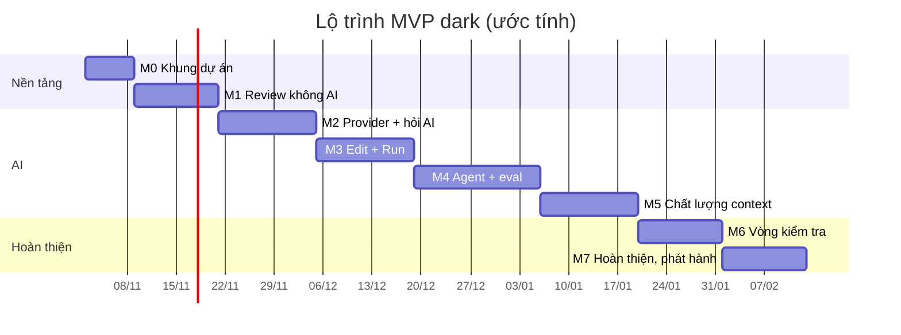

# dark — Kế hoạch phát triển MVP

> Phiên bản: 0.1 (pre-MVP) · Cập nhật: 01/11/2026
> Liên quan: [ARCHITECTURE.md](ARCHITECTURE.md) · [FEATURES.md](FEATURES.md) · [SEQUENCE.md](SEQUENCE.md)

## 1. Mục tiêu MVP

- Review được mọi thay đổi AI tạo ra: theo file, theo hunk, giữ/bỏ, hỏi AI, áp dụng patch có duyệt.
- Gọi được nhiều model (Anthropic, Gemini, OpenAI-compatible, local) với chất lượng **ngang hoặc hơn opencode** trên cùng model.
- Agent làm được task có sửa nhiều file, tự kiểm tra bằng lint/typecheck/test.
- **RSS của app dưới 10 MB** trong mọi kịch bản test.
- Chạy trên **Windows** (máy phát triển chính), macOS, Linux.

## 2. Nguyên tắc làm việc

1. **Bài test RAM có từ ngày đầu** và chạy ở mỗi milestone. Vượt 10 MB thì dừng thêm tính năng, xử lý trước.
2. **Chất lượng AI đo bằng eval, không đo bằng cảm giác.** Bộ eval có từ M4.
3. Mỗi milestone kết thúc bằng một bản chạy được và dùng thật được.

## 3. Các milestone

Thời gian là **ước tính cho một người làm, có AI hỗ trợ**, cần điều chỉnh theo thực tế.

| Milestone | Nội dung | Ước tính | Tính năng (xem FEATURES.md) |
|---|---|---|---|
| **M0** Khung dự án | Event loop 1 luồng, renderer, đổi màn hình, bài test RAM, build tối ưu kích thước | 1 tuần | U1 (khung), U5 |
| **M1** Review không AI | Snapshot, đọc git diff, tách hunk, giữ/bỏ, danh sách file | 1–2 tuần | R1–R4, G1, U1 |
| **M2** Provider + hỏi AI | Adapter 3 loại provider qua `curl`, stream SSE, ô hỏi AI, nhận xét dưới dòng, màn chọn model | 2 tuần | A1–A3, A11, R5, U3, G4 |
| **M3** Edit + Run | Editor rope, tìm/thay, tìm file, chạy test, áp dụng patch có duyệt | 2 tuần | E1–E3, E5, V1, R6, G3, U2 |
| **M4** Agent | Agent loop, bộ công cụ, edit engine (khớp gần đúng), quy tắc project, **bộ eval đầu tiên** | 2–3 tuần | A4, A5, A8 |
| **M5** Chất lượng context | Repo map tree-sitter, định dạng sửa theo model, compaction, prompt caching, ngân sách chi phí | 2 tuần | A6, A7, A9, A10, A12 |
| **M6** Vòng kiểm tra | Verify loop tự động, nhảy tới lỗi, LSP lazy (tùy chọn), commit có gợi ý AI | 1–2 tuần | V2–V4, G2, E4, R7 |
| **M7** Hoàn thiện | So eval với opencode, chế độ hiển thị đầy đủ/tối giản, tài liệu, đóng gói phát hành | 1–2 tuần | U4 |

**Tổng ước tính:** khoảng 12–16 tuần.

## 4. Tiêu chí hoàn thành từng milestone

### M0 — Khung dự án
- [x] `cargo build --release` Windows ra binary dưới 3 MB (170.496 byte).
- [x] Mở app Windows, chuyển giữa 3 màn trống bằng phím, thoát sạch.
- [ ] Bài test RAM chạy được trên Windows và Linux; RSS khi rảnh dưới 2 MB.
- [x] Trên Windows: `cargo fmt --check`, `cargo clippy --all-targets -- -D warnings`, `cargo test` và `cargo test --release` đạt; test RAM debug được bỏ qua kèm lý do.
- [x] Console thật Windows được kiểm tra với resize, `q`, `Ctrl-C` và panic subprocess ở cả debug/release; terminal được phục hồi.

M0 chưa đóng: Linux đã cài Rust stable trong WSL bằng tài khoản người dùng, build riêng tại `~/dark-target`. Format, Clippy, test chức năng và TUI đạt, nhưng bài test RAM release GNU còn vượt 2.000.000 byte trong một số lần chạy, nên tiêu chí RAM vẫn chưa được đánh dấu đạt. Windows headless và console release đã đạt ngân sách; người dùng sẽ tự kiểm tra lại Windows trước khi đóng M0. macOS ARM64 mới qua `cargo check --target aarch64-apple-darwin`; build release chưa link được vì máy Windows thiếu Apple SDK/linker, chưa chạy thực tế. Chưa push hoặc tag M0. Xem output thực tế và giới hạn tại [M0_VERIFICATION.md](M0_VERIFICATION.md).

Ngân sách M0 tính theo byte: idle **< 2.000.000**, giới hạn cứng **< 10.000.000**, binary **< 3.000.000**. RAM được đo trên binary release, không phải test runner. Windows dùng private working set (`PROCESS_MEMORY_COUNTERS_EX2`), Linux dùng `VmRSS`; các số đo khác nhau phải ghi đúng tên. Windows không hỗ trợ EX2 thì hiện `n/a` và lý do, không đổi sang số đo khác. Linux được chạy trong WSL nếu môi trường có Rust; nếu chưa chạy được phải ghi rõ. macOS build khi có môi trường phù hợp và ghi rõ chưa kiểm chứng thực tế.

### M1 — Review không AI
- [ ] Trên một repo thật, xem đúng danh sách file đổi so với snapshot.
- [ ] Giữ/bỏ từng hunk, kết quả khớp với `git diff` sau đó.
- [ ] Diff 2.000 dòng: RSS dưới 4 MB, cuộn mượt.

### M2 — Provider + hỏi AI
- [ ] Hỏi được cả 3 loại provider và ít nhất 1 model local.
- [ ] Stream mượt, không đứng giao diện khi đang nhận.
- [ ] Thiếu key hoặc lỗi mạng: thông báo rõ, không crash.
- [ ] RSS khi stream dưới 3 MB (không tính curl).

### M3 — Edit + Run
- [ ] Sửa, lưu, undo/redo đúng trên file 10.000 dòng.
- [ ] Chạy test, thấy lỗi đầu tiên và vị trí.
- [ ] Patch AI chỉ ghi file sau khi người dùng duyệt.

### M4 — Agent
- [ ] Agent hoàn thành task sửa nhiều file trên repo mẫu.
- [ ] Edit engine: khi model chép sai khoảng trắng vẫn khớp; khi không khớp thì báo lỗi đủ rõ để model tự sửa.
- [ ] Bộ eval 20–30 task thật, có script chạy tự động và ghi kết quả.

### M5 — Chất lượng context
- [ ] Repo map tạo xong rồi giải phóng; đỉnh RSS dưới 8 MB.
- [ ] Phiên dài vượt context window vẫn chạy tiếp nhờ compaction.
- [ ] Prompt caching hoạt động (xác nhận qua usage trả về).

### M6 — Vòng kiểm tra
- [ ] Sau mỗi lần sửa, lỗi lint/test được tự đưa lại cho model.
- [ ] LSP chỉ chạy khi cần, tự tắt khi rảnh, tắt hẳn được trong config.

### M7 — Hoàn thiện
- [ ] Trên bộ eval, cùng model: tỉ lệ hoàn thành **≥ opencode**, số lượt trung bình **≤ opencode**.
- [ ] Mọi kịch bản test RAM dưới 10 MB.
- [ ] README đủ để người mới cài và dùng trong 5 phút.

## 5. Đo chất lượng so với opencode

| Chỉ số | Cách đo |
|---|---|
| Tỉ lệ hoàn thành task | Test của task pass sau khi agent dừng |
| Số lượt gọi model | Đếm request mỗi task |
| Tỉ lệ sửa file thành công | Số lần `edit_file` áp dụng được / tổng số lần gọi |
| Lỗi lọt qua | Lỗi lint/typecheck còn lại khi agent báo xong |
| Chi phí | Token vào/ra, có tính cache |

Quy tắc: luôn dùng **cùng model, cùng task, cùng trạng thái repo** cho cả hai harness. Chạy mỗi task ít nhất 3 lần để giảm nhiễu.

## 6. Quyết định còn mở

| Câu hỏi | Lựa chọn | Thời điểm cần chốt |
|---|---|---|
| Renderer tự viết hay ratatui? | Tự viết (nhẹ hơn ~1 MB) / ratatui (nhanh làm hơn) | Đầu M0 |
| HTTPS qua `curl` hay nhúng `ureq` + `rustls`? | curl (app nhẹ hơn) / ureq (tổng RAM thấp hơn, không phụ thuộc curl) | Đầu M2 |
| Chế độ hiển thị mặc định? | Đầy đủ / tối giản | M7 |
| Ngôn ngữ giao diện? | Tiếng Anh / tiếng Việt / cả hai | M7 |
| Có hỗ trợ MCP trong MVP? | Có / để sau | Cuối M5 |

## 7. Rủi ro lớn nhất

Xem bảng rủi ro chi tiết trong [ARCHITECTURE.md](ARCHITECTURE.md#8-rủi-ro-và-cách-giảm). Hai rủi ro cần theo dõi sát:
1. **Chất lượng agent** không đạt mức opencode → bộ eval từ M4, ưu tiên edit engine và verify loop.
2. **RAM phình dần** khi thêm tính năng → bài test RAM chạy ở mọi milestone.
