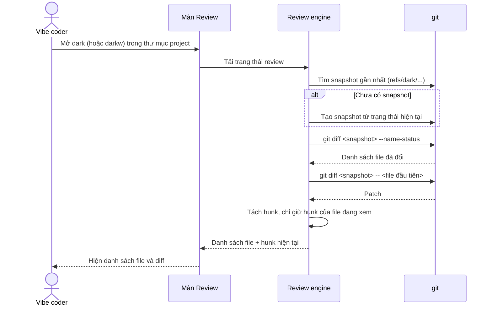
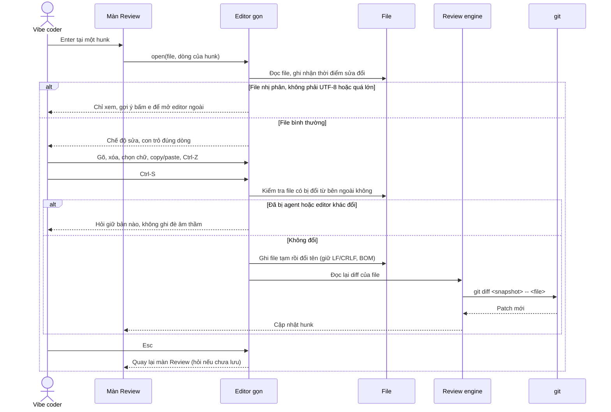
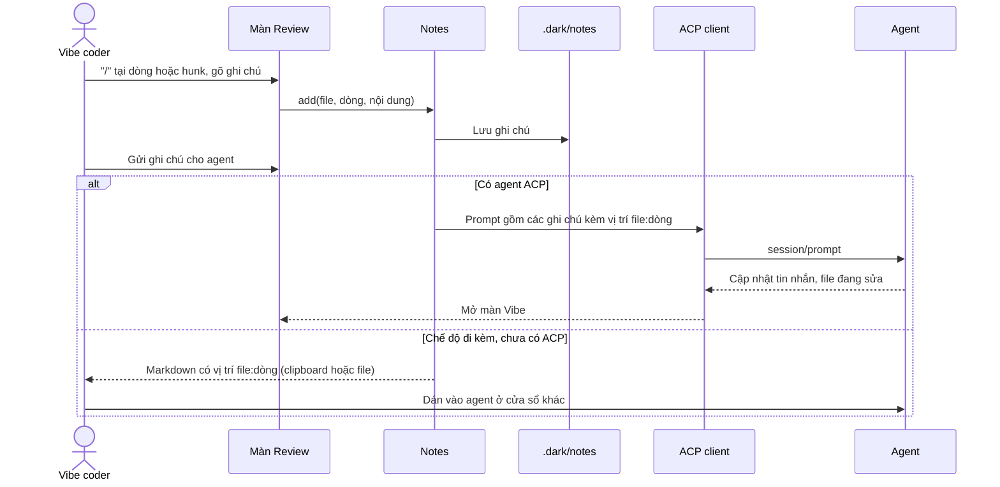
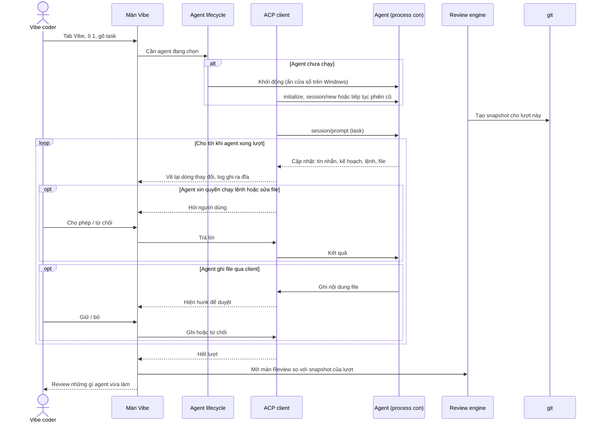
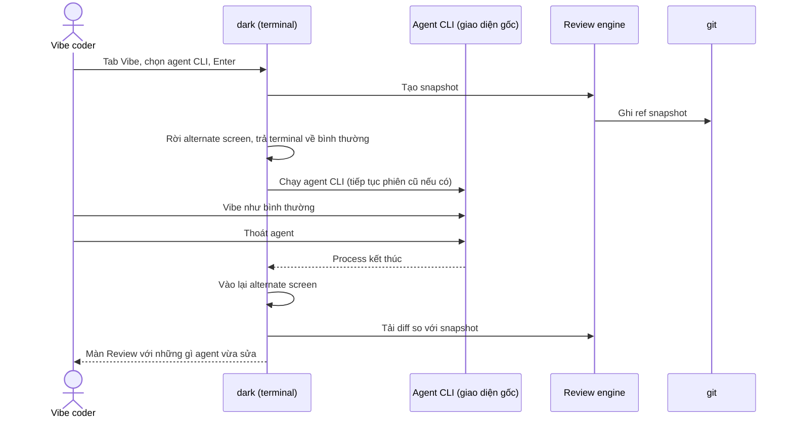
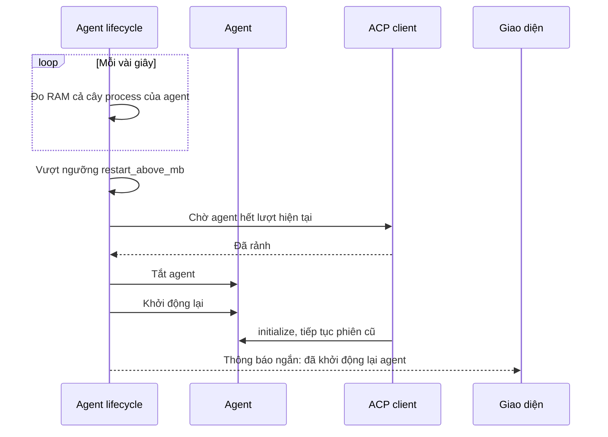
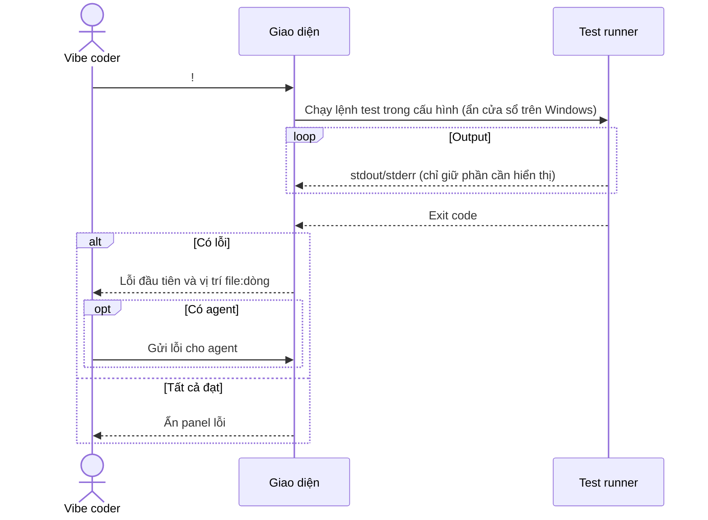
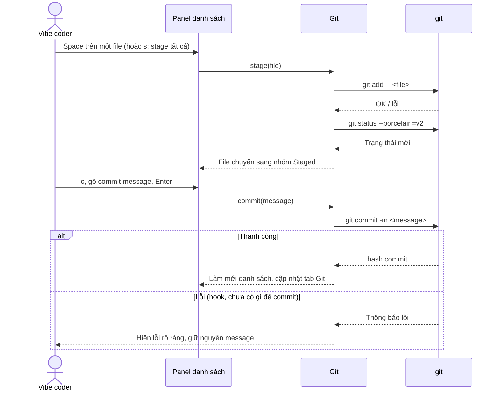
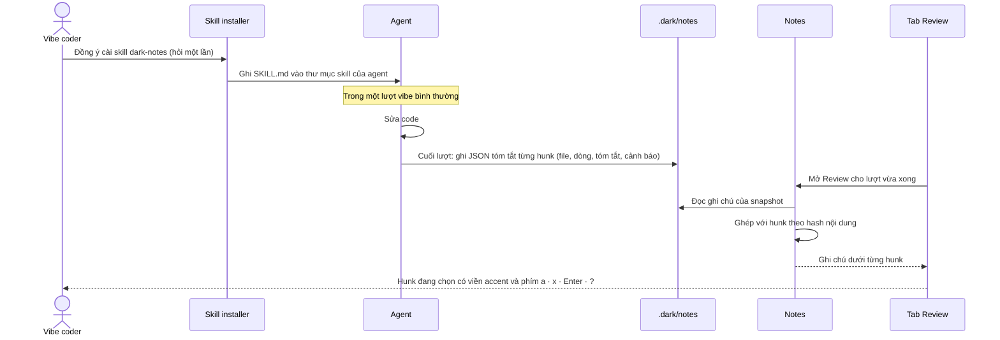
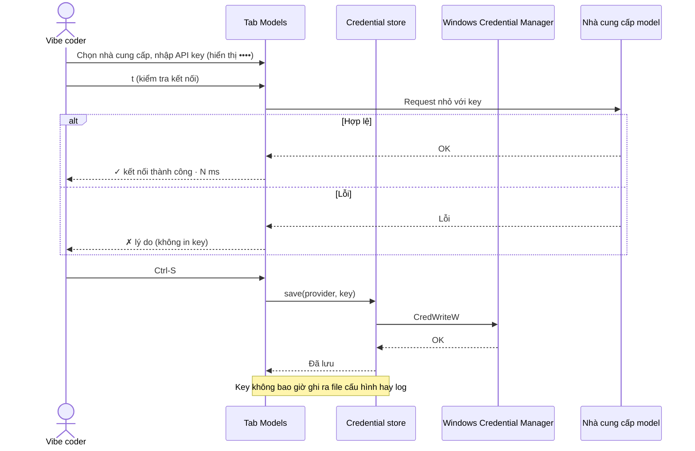

# dark — Sơ đồ tuần tự

> Phiên bản: 0.3 · Cập nhật: 01/11/2026
> Liên quan: [ARCHITECTURE.md](ARCHITECTURE.md) · [FEATURES.md](FEATURES.md) · [UI_SPEC.md](UI_SPEC.md) · [PLANNING.md](PLANNING.md)

Quy ước: `git`, agent, editor, test runner là **process con** hoặc chương trình riêng. dark chỉ đọc output của chúng; RAM của chúng đo riêng.

## 1. Mở phiên review (M1)

## 2. Giữ / bỏ hunk, hoàn tác cả lượt (M1)

## 3. Sửa code ngay trong dark (M2)

## 4. Ghi chú của người dùng gửi cho agent (M5)

## 5. Vibe qua ACP (M5)

## 6. Gọi agent CLI từ tab Vibe (M3, bản terminal)

## 7. Khởi động lại agent khi phình RAM (M5)

## 8. Chạy test (M3)

## 9. Stage và commit từ panel Review (M3)

## 10. Ghi chú AI cho từng hunk qua skill dark-notes (M5)

## 11. Lưu API key ở tab Models (M6)

