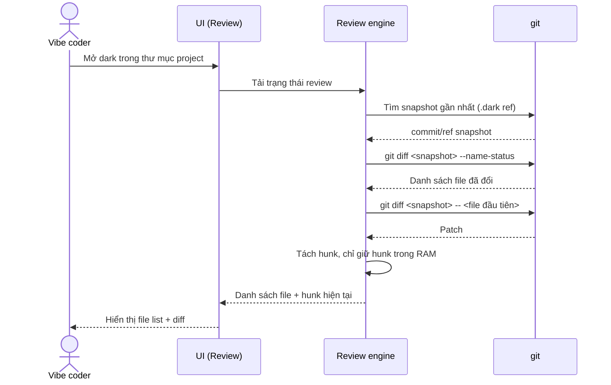
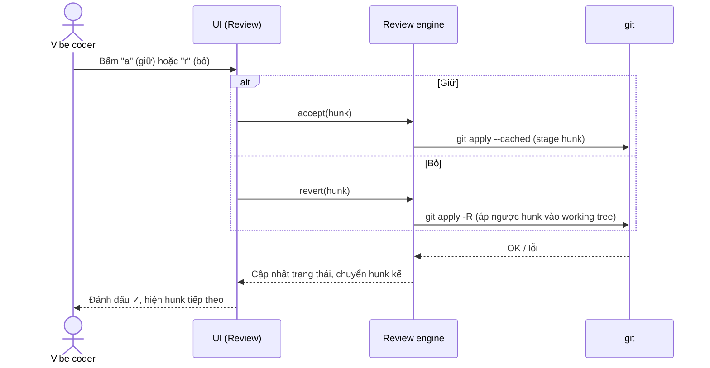
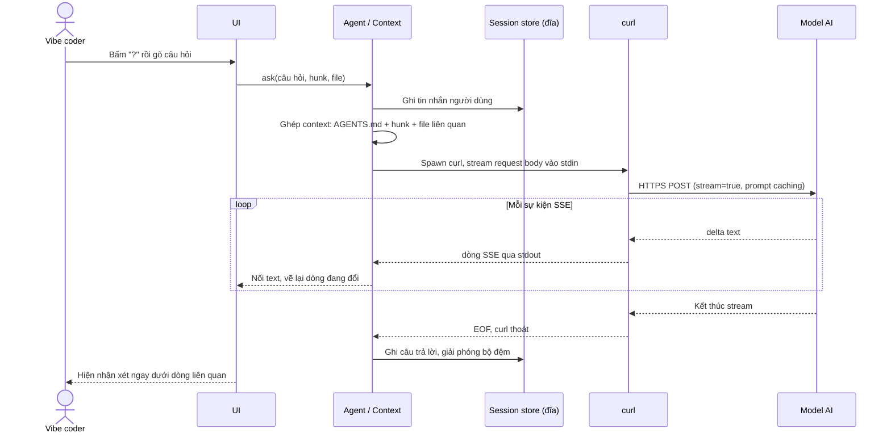
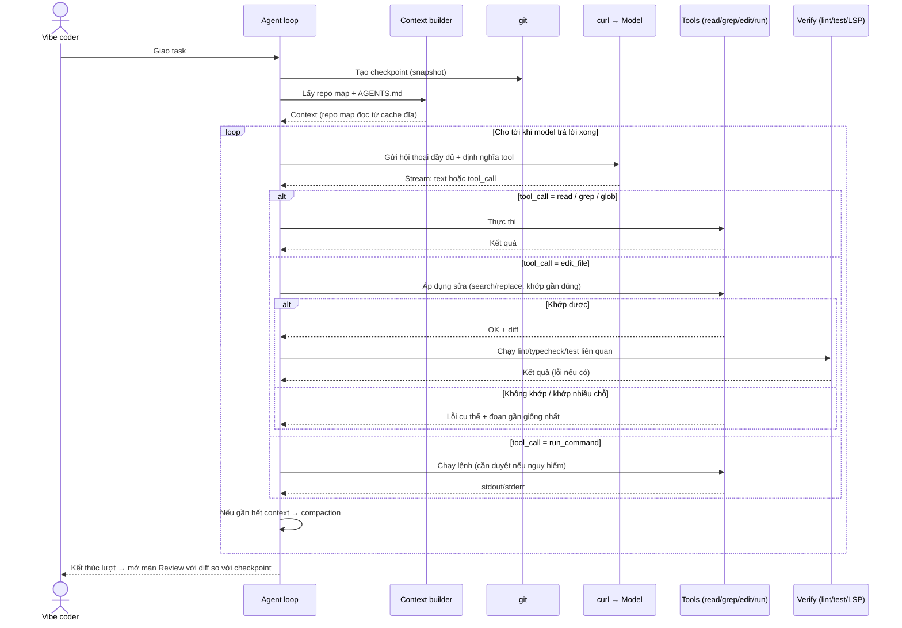
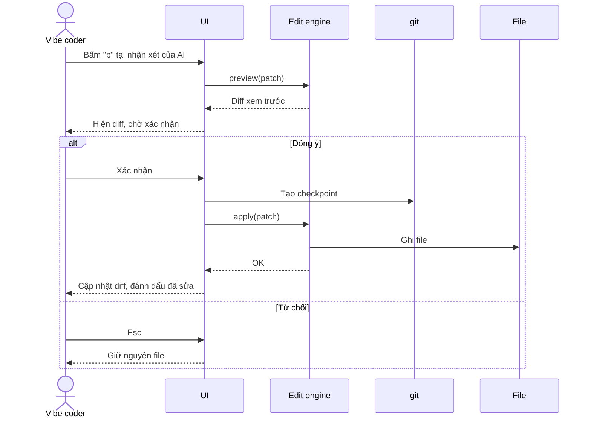
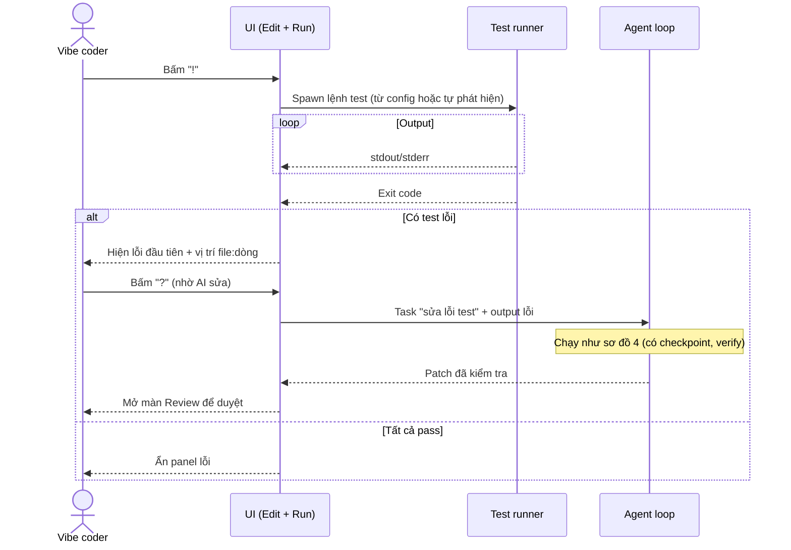
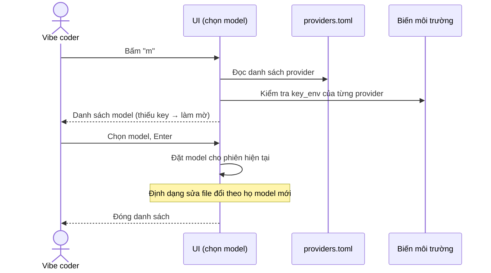

# dark — Sơ đồ tuần tự

> Phiên bản: 0.1 (pre-MVP) · Cập nhật: 01/11/2026
> Liên quan: [ARCHITECTURE.md](ARCHITECTURE.md) · [FEATURES.md](FEATURES.md)

Quy ước: `curl`, `git`, `rg`, test runner và LSP đều là **process con**. App chỉ đọc output của chúng qua pipe trong một vòng lặp sự kiện duy nhất.

## 1. Mở phiên review sau khi vibe code

## 2. Giữ hoặc bỏ một hunk

## 3. Hỏi AI về một hunk (stream câu trả lời)

## 4. Agent thực hiện task (vòng lặp công cụ + kiểm tra)

## 5. Áp dụng patch AI đề xuất (có duyệt)

## 6. Chạy test và nhờ AI sửa lỗi

## 7. Đổi model

