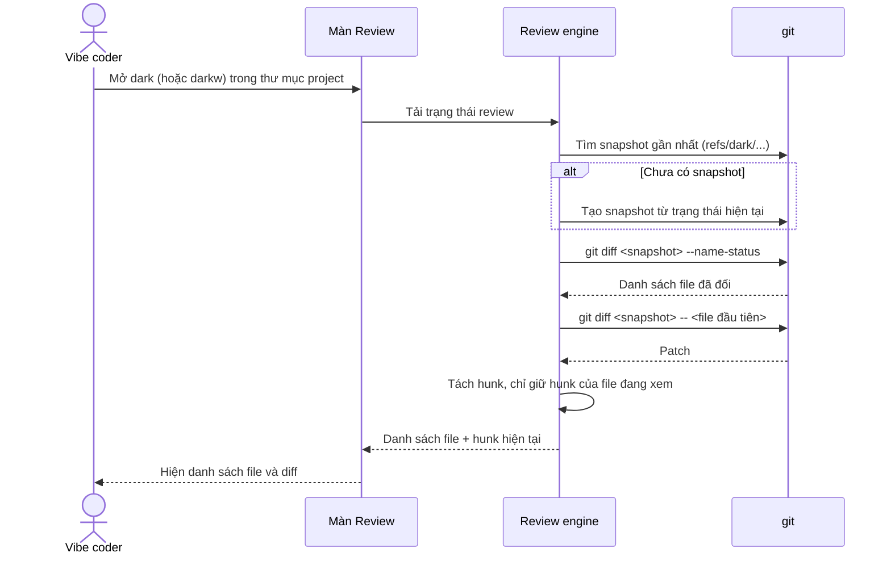
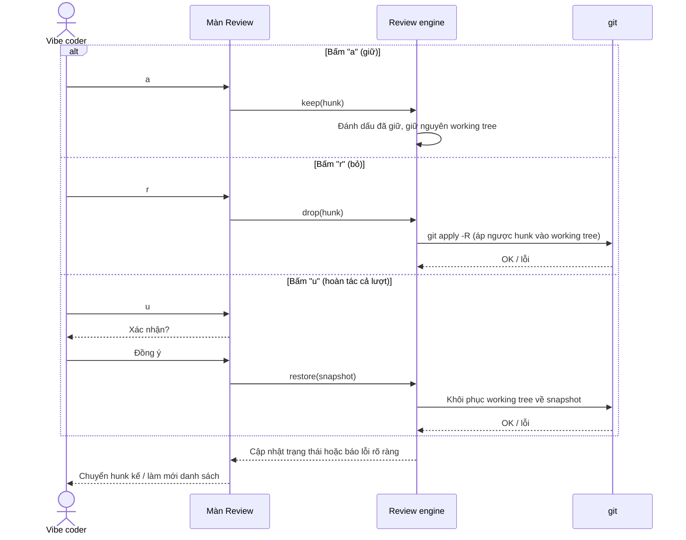
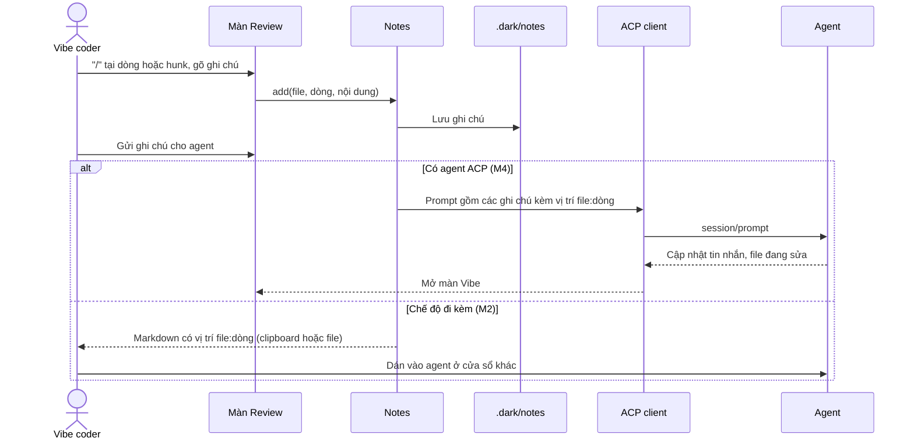
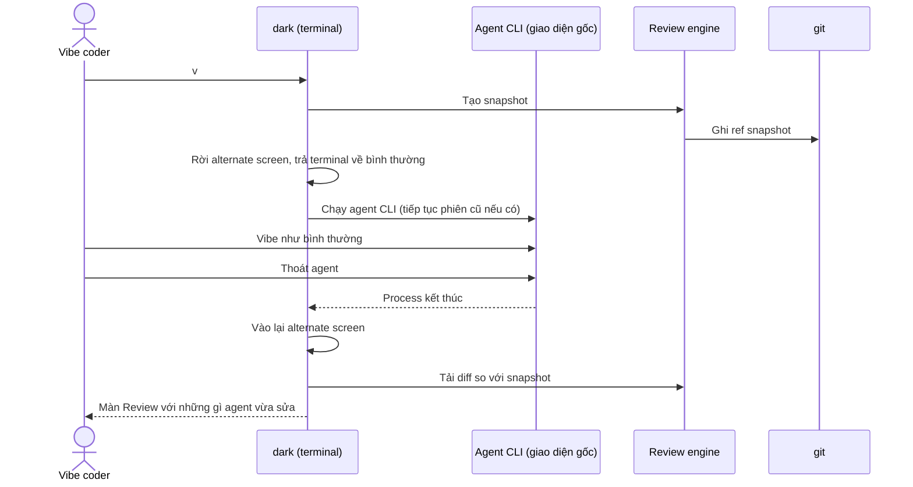
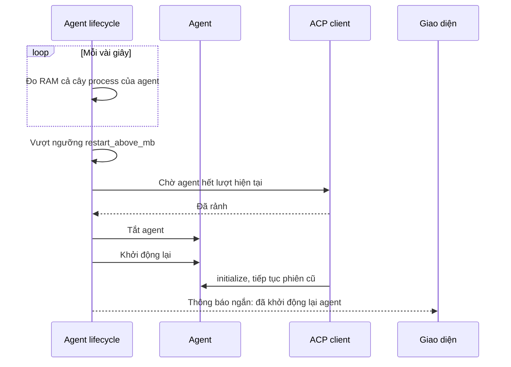
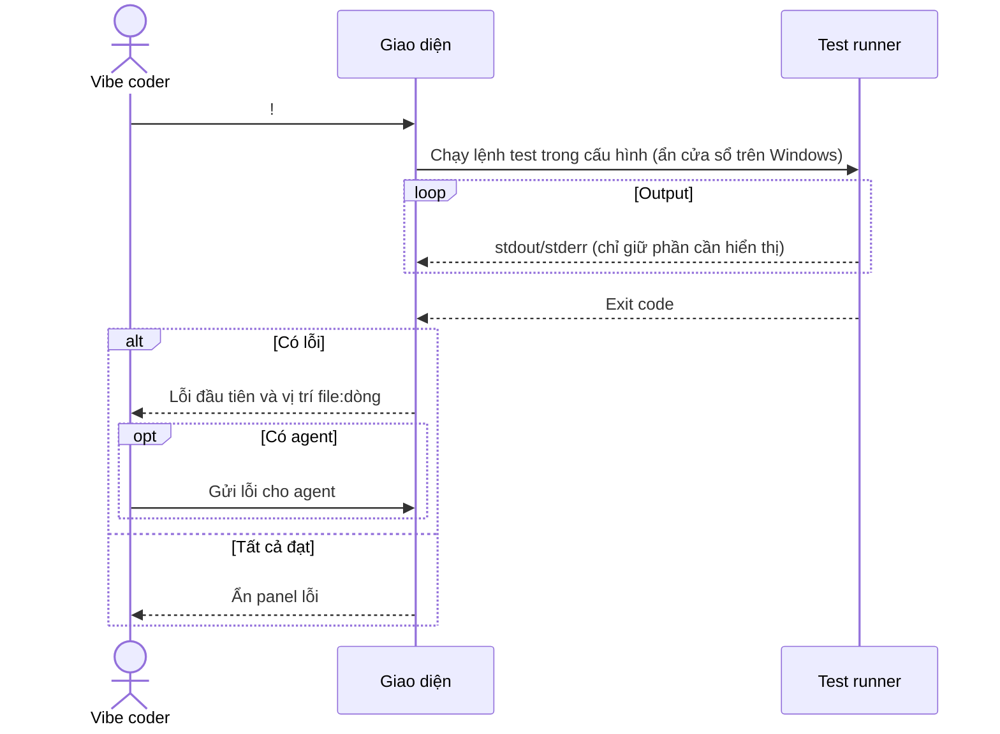

# dark — Sơ đồ tuần tự

> Phiên bản: 0.2 (sau M0) · Cập nhật: 01/11/2026
> Liên quan: [ARCHITECTURE.md](ARCHITECTURE.md) · [FEATURES.md](FEATURES.md) · [PLANNING.md](PLANNING.md)

Quy ước: `git`, agent, editor, test runner là **process con** hoặc chương trình riêng. dark chỉ đọc output của chúng; RAM của chúng đo riêng.

## 1. Mở phiên review (M1)

## 2. Giữ / bỏ hunk, hoàn tác cả lượt (M1)

## 3. Ghi chú và gửi cho agent (M2 xuất markdown, M4 qua ACP)

## 4. Vibe qua ACP (M4)

## 5. Nhường màn hình cho agent CLI (M2, bản terminal)

## 6. Khởi động lại agent khi phình RAM (M4)

## 7. Chạy test (M2)

